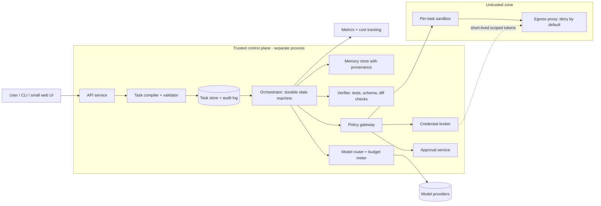
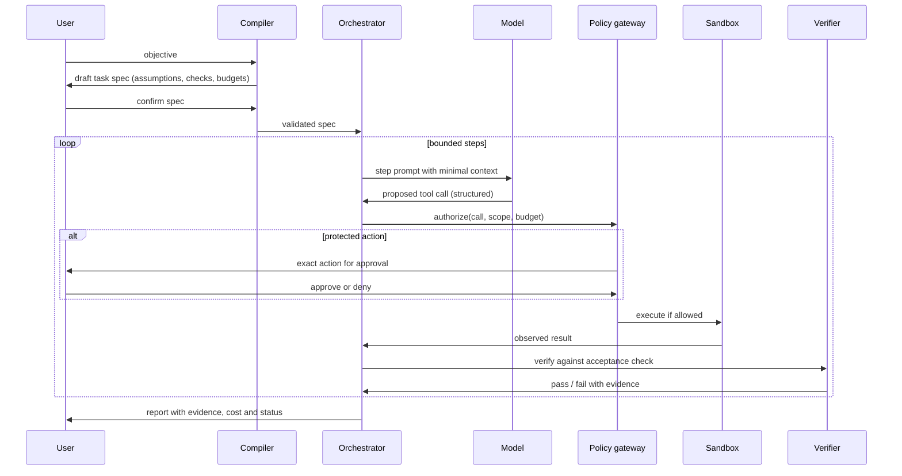
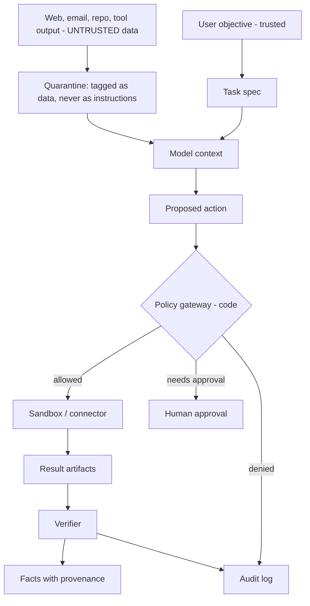

# Secure Agentic OS: Research and Architecture Blueprint

*Version 0.8 · October 17, 2026 · Design-review draft. No implementation code, as requested. (v0.7 → v0.8: 10 H-class design holes closed; see §19.)*

## Contents

- 0. Method, evidence legend and limits
- 1. Executive assessment (Deliverable 1)
- 2. Competitive research (Deliverable 2)
- 3. Requirements and scope (Deliverable 3)
- 4. Recommended architecture (Deliverable 4)
- 5. Technical decisions (Deliverable 5)
- 6. Agent and orchestration specification (Deliverable 6)
- 7. Tool development and integration specification (Deliverable 7)
- 8. Security blueprint (Deliverable 8)
- 9. Evaluation and economics (Deliverable 9)
- 10. Business workflows (brief §9)
- 11. Phased roadmap (Deliverable 10)
- 12. Initial implementation backlog (Deliverable 11)
- 13. Implementation readiness check (Phase 4 of the method)
- 14. Revision 0.2: merged with a second blueprint
- 15. Revision 0.3: honest competitive positioning
- 16. Revision 0.5: custom and AI-built agents, bring-your-own-model, premade specialists (incl. §16.11 AutomationSpec, designed, not built)
- 17. Revision 0.6: looped verification, custom workflows and the wedge
- 18. (reserved; v0.8 changes live in §19, not a new top-level section)
- 19. Revision 0.8: solidification (10 H-class design holes closed)
- (v0.8 = 10 H-class design holes closed across §6.2, §6.8, §8.9, §9.7, §15.3, §16.10, §16.11; see §19)

## 0. Method, evidence legend and limits

**Evidence tags.** **V** = verified in official docs or code. **I** = credible independent evidence. **C** = vendor claim not independently established. **U** = unclear, unavailable or unverified.

**What was and was not checked.** Official pages were read for Grok Build, Grok Bot and the OWASP Agentic Top 10. Antigravity and Claude Code were checked through third-party documentation mirrors, community SDK repos and tutorials, so their tags are weaker. **Not verified:** current Claude Code and Antigravity subscription prices, Grok Build's sandbox internals, hosting prices, and any measurement of how much orchestration helps weak models. These are tagged **U** and §9 lists the experiments that would close them. Several framework and sandbox sources are secondary roundups. Prices are list prices reported by aggregators between Oct 8 and Oct 16, 2026, and the aggregators disagree in places (noted where it matters).

**Assumptions** (change these and the plan changes):

- A1: the first builder is one person.
- A2: **Go 1.23 backend** (revised from Python in
  v0.9; the PRD is the source of truth, this
  blueprint's earlier Python framing is
  historical).
- A3: Linux host with **gVisor or a microVM
  for production isolation; Docker is
  acceptable for local development only**
  (revised from "Docker available" in v0.9
  per §14 of the PRD).
- A4: the first workflow is software delivery in a sandboxed repository.
- A5: prototype budget under about $50/month.

## 1. Executive assessment (Deliverable 1)

**Proposal.** Build a small durable task runner, not a platform. A user states an objective. A compiler turns it into a machine-readable task spec (outcome, inputs, acceptance checks, tool scope, risk tier, budgets). A bounded loop executes steps in a sandbox through a **policy gateway that is ordinary code outside the model**. A verifier checks results with tests and schema checks before any model opinion counts. Risky actions wait in an approval queue. Every step is checkpointed and audited.

**Strongest ideas learned from the products**

1. **Enforcement below the model.** Claude Code documents two layers: permissions that stop the agent from attempting restricted actions, and OS-level sandboxing that restricts filesystem and network access even if a prompt injection fools the model (V, official docs via index). Adopt.
2. **Hooks as deterministic policy points.** Antigravity's SDK exposes nine lifecycle hooks, and a raising pre-tool decide hook aborts the tool, i.e. fails closed (I). Adopt, but make fail-closed the rule for every critical check; one security integration for Antigravity deliberately fails open on permission-service outages (I), which is the wrong default for us.
3. **Skills as reusable procedural memory.** All three coding agents ship a skills/plugins convention. Adopt, kept separate from facts and from policy.
4. **Subagents with isolated context that return summaries.** Adopt with one worker plus one independent verifier first.
5. **Headless mode and ACP as integration surface.** Grok Build runs interactively, headlessly and as an ACP agent (V). Adopt: lets us drive existing agents as workers instead of rebuilding them.
6. **A cautionary lesson from Grok Bot.** Launch copy says Bots have their own computer, while xAI's docs say all of an account's Bots share one cloud computer and the security boundary is the account, not the Bot (V for the docs; I for the discrepancy report). Never treat agent identity as isolation.

**What is realistically achievable.** An MVP that completes well-specified software tasks with evidence (passing tests, diffs, logs), enforces budgets and approvals, and resumes after a crash. Gains for weaker models from small tasks, constrained tools and test-based verification are well-motivated but **unmeasured (U)**. Do not promise parity with frontier models; the plan includes an experiment (E1) to find the boundary.

**Prioritize:** task spec and state machine, policy gateway, sandboxed execution, test-based verification, approval queue, audit log, budgets, benchmark harness. **Defer:** parallel agents, business connectors beyond read-only, self-built tools in production, persistent shared VM, browser computer-use, multi-user tenancy. **Avoid:** agent hierarchies, an LLM as the security boundary, broad default permissions, agents editing their own policy, always-on unattended outbound messaging.

**Key trade-offs.** (1) Autonomy vs verifiability: start with workflows whose success is machine-checkable. (2) Per-task isolation vs speed: pay a few seconds of sandbox start-up for blast-radius control. (3) Library vs service for durability: choose the lighter library until a threshold says otherwise. (4) Model quality vs cost: route by risk and difficulty, measure cost per verified task.

## 2. Competitive research (Deliverable 2)

Sources retrieved Oct 17, 2026. Dates are publication or last-update where the page showed one.

### 2.1 Comparison matrix

| Dimension | Grok Build | Grok Bot | Claude Code | Antigravity 2.0 / agy |
| --- | --- | --- | --- | --- |
| Product | Terminal coding agent (Rust TUI + runtime); early beta from May 2026 (I) | Persistent named agents on a cloud computer; early beta launched Aug 11, 2026 (V/I) | Terminal/IDE/web coding agent | Platform: desktop app, CLI, SDK, Managed Agents API, enterprise platform (I) |
| Planning/delegation | Plan mode reported as default for non-trivial work (I); subagents listed in third-party and fork docs (I) | Multi-Bot delegation and routines (C/I) | Plan modes, subagents with own context windows (I) | Subagents via SDK builtin; `/agents` monitoring (I) |
| Persistence/memory | Config, instructions, skills, plugins discovered per directory (`grok inspect`) (V) | Memory, files, logins persist on one account-level VM (V/I) | CLAUDE.md read each session, checkpoints (V/I) | Rules/AGENTS.md, plugins, conversation resume (I) |
| Interfaces | Files, shell, web search, MCP; headless `-p`; ACP over stdio (V) | Browser, filesystem, terminal, connectors, MCP, computer use (V) | Files, shell, MCP, hooks, headless (V/I) | Terminal, IDE extensions via ACP adapters, MCP (I) |
| Model flexibility | Custom models via `~/.grok/config.toml`; gateway routing documented by a third party (V/I) | xAI models only (V per vendor page) | Anthropic models (V); community migration guides to other agents (I) | Gemini-centred; SDK, ACP wrappers (I) |
| Security controls | Sandboxing and hooks listed in user guide (V, not tested); permission details U | Account-level boundary; Bots not isolated from each other (V); consequential-action supervision judged weak by a reviewer (I) | Permissions + OS sandbox + hooks, defence-in-depth (V) | allow/ask/deny engine, 5-event hook system, terminal sandbox with native OS isolation (I); reported MCP isolation gap for subagents, SDK issue #65 (I, community) |
| Reliability record | 70.8% SWE-bench Verified reported for grok-build-0.1 as of May 15, 2026 (C/I, secondhand) | No proven record; reviewers call it supervised-use only (I) | Not re-verified (U) | Not verified (U) |
| Cost (list) | SuperGrok $30/month reported (I); API \~ $1/$2 per M tokens for grok-build-0.1 per one tracker (I) | Reported bundled from $120/seat/month (I, third-party) | U | U |
| Extension | MCP, skills, plugins, hooks, ACP (V, doc list) | Skills, routines, connectors, MCP (V/C) | Skills, subagents, hooks, plugins, MCP (V/I) | Skills, hooks, subagents, plugins, MCP; Python hook decorators in SDK (I) |
| Main limitation | Beta; Cloudflare-walled install host reported (I) | Shared computer = shared blast radius; beta | Cost and approval fatigue patterns not measured here (U) | Hook registration requires SDK integration; MCP isolation caveat (I) |

Key links: [Grok Build repo](https://github.com/xai-org/grok-build) · [Grok Build docs](https://docs.x.ai/build/overview) · [Grok Bot docs](https://docs.x.ai/grok-bot/overview) · [Grok Bot discrepancy analysis](https://www.digitalapplied.com/blog/grok-bot-ai-teammates-launch-cloud-computer-2026) · [Grok Bot review](https://www.layer3labs.io/guides/grok-bot-review) · [Grok Build overview (Wikipedia)](https://en.wikipedia.org/wiki/Grok_Build) · [Antigravity controls](https://agenticcontrolplane.com/controls/antigravity) · [Antigravity ACP adapter notes](https://github.com/jiridanek/agy-acp) · [Ory hooks for Antigravity](https://pypi.org/project/ory-antigravity/) · [Claude Code docs index](https://docsearch.algolia.com/mcp/docs/website/code.claude.com).

### 2.2 Pattern verdicts

| Capability / pattern | Why it is valuable | Adopt pattern? | How we improve it | Stage | Source |
| --- | --- | --- | --- | --- | --- |
| Deny-first permissions + OS sandbox | Holds even when the model is fooled | Yes | Policy gateway is a separate process; sandbox is per task, network deny-by-default | MVP | Claude Code docs index |
| Pre/post tool hooks | Deterministic interception and logging | Yes | Fail closed always; hooks signed and read-only to agents | MVP | Antigravity SDK notes; Ory integration |
| Plan-first execution | Catches misunderstanding before side effects | Yes | Plan is a validated task spec, not prose | MVP | Grok Build review (I) |
| Skills/plugins | Reusable procedures | Yes | Versioned, tested, no privilege grant | MVP (basic) | all four |
| Subagents with own context | Limits context bloat | Yes, narrowly | Return structured result + evidence only | MVP: worker+verifier only | Claude Code, Antigravity |
| Headless + ACP | Embeds agents as workers | Yes | Treat external agents as untrusted workers behind the gateway | Phase 2 | Grok Build docs |
| Persistent shared cloud VM | Works on sites with no API | Not as designed | Per-task ephemeral browser profile, scoped credentials | Defer | Grok Bot docs |
| Routines / scheduled work | Repeatable ops | Yes | Idempotency keys, approval at protected boundaries | Phase 3 | Grok Bot (C) |
| Account-level credential sharing | Easy handoffs | Reject | Per-task short-lived credentials | Reject | Grok Bot docs |
| Hook fail-open on outage | Availability | Reject for critical checks | Fail closed; degrade to read-only | Reject | Ory notes |
| Worktrees / parallel agents | Throughput | Later | Only after conflict and cost measurements | Defer | Grok Build docs list |

### 2.3 Additional systems (selected for the decisions they inform)

| System | Finding | Evidence | Verdict |
| --- | --- | --- | --- |
| [DBOS Transact](https://github.com/dbos-inc/dbos-transact-py) | Durable workflows as a library checkpointing to Postgres; no separate orchestrator; durable queues; a July 2026 release adds a Temporal-Python-compatible layer (I) | V (repo) + I | **Recommended** for durability once Postgres is acceptable |
| Temporal | Needs a separate server and moving code into workers (V per DBOS docs; vendor-adjacent) | I | Reject for MVP; revisit at high throughput |
| LangGraph | Widely used agent-flow library; roundups favour it as the production spine (I, secondary) | I | Optional; our loop is small enough to hand-write first |
| [OpenHands](https://aiagentrank.io/blog/best-open-source-ai-agent-frameworks-2026) | Self-hostable open coding agent; Docker required, token-heavy (I, secondary) | I | Candidate worker for benchmarks, not a base |
| Pydantic AI / Letta | Typed outputs; long-term memory store (I, secondary) | I | Pydantic for schemas yes; Letta deferred |
| E2B | Firecracker microVMs, Apache-2.0 core, Sept 30 2026 single-host self-host package with secrets/volumes cloud-only (I) | I | Use for hosted sandbox option |
| Daytona | Containers by default; core moved to a private codebase in June 2026 (I) | I | Reject (lock-in, closed core) |
| gVisor / Firecracker self-hosted | Free; microVM or user-space-kernel isolation (I) | I | gVisor/Docker for prototype; Firecracker later |
| MCP | Common tool-connection protocol; has its own OWASP list (I) | I | Adopt, behind allowlist |

### 2.4 Meaningful unknowns that could change the design

1. How much do weaker models gain from orchestration on our own tasks? (E1)
2. Do Grok Build's sandbox and permission settings enforce what the docs imply? (E2)
3. Real approval-fatigue rates for risk-tiered prompts. (E3)
4. Whether DBOS on SQLite-class hardware is adequate, or Postgres is needed from day one. (E4)
5. Current Claude Code and Antigravity pricing and rate limits (not retrieved).
6. Terms of service for browsing/prospecting platforms used in Workflow A/B (per-site check required).

## 3. Requirements and scope (Deliverable 3)

### 3.1 Functional requirements (MVP unless marked)

- FR1 Compile an objective into a validated task spec; refuse to run if acceptance checks are missing.
- FR2 Execute a bounded loop: plan, step, observe, verify, then retry/replan/escalate/stop.
- FR3 Run code and commands only inside a per-task sandbox.
- FR4 Route every tool call through the policy gateway (allowlist, scope, budget, risk tier).
- FR5 Require approval for protected actions with exact-action binding, expiry and duplicate protection.
- FR6 Persist task state; resume after crashes without repeating side effects.
- FR7 Store verified facts with provenance separately from preferences and skills.
- FR8 Produce a final report with evidence: diff, test output, logs, cost, status.
- FR9 (Phase 2) Register new tools via the pipeline in §7.
- FR10 (Phase 3) Read-only business connectors, then draft-only communications.
- FR11 (Phase 4) Parallel tasks with isolated workspaces.

### 3.2 Non-functional requirements

Cost cap per task and per day; deadline per task; at most N retries per step; secret redaction in logs; deterministic replay of state transitions; model-provider interchangeability behind one interface; startup of the MVP on one machine; every claim in a report traceable to an artifact.

### 3.3 Explicit safety boundaries

The system never: sends external messages, publishes, spends money, deletes important data or changes permissions without a matching approval; reads secrets from model context; modifies its own policy, gateway, orchestrator or audit log; follows instructions found in untrusted content; or claims completion without verification evidence.

### 3.4 Acceptance criteria for the MVP

- 100% of adversarial tests that request protected actions are blocked by the gateway, not by the model.
- Crash at any step resumes with no duplicate side effects in the fault-injection suite.
- Final reports contain no unverified success claims on the benchmark (false-success rate target 0 in the suite; measured, not assumed).
- Median cost and time per verified task recorded for at least two model classes.

### 3.5 Vision vs minimum useful product

**Vision:** a workforce across engineering, research and business operations with parallel agents, self-built tools and recurring workflows. **MVP:** one worker plus one verifier completing sandboxed software tasks with approvals, budgets and audit.

## 4. Recommended architecture (Deliverable 4)

### 4.1 Component diagram



### 4.2 Task execution sequence



### 4.3 Data-flow diagram



### 4.4 Components and process boundaries

| Component | Responsibility | LLM needed? | Separate process? |
| --- | --- | --- | --- |
| API service | Auth, submit/inspect tasks, approval UI endpoints | No | Control plane |
| Task compiler | Draft spec from objective; validator is code | Draft yes, validate no | Control plane |
| Orchestrator | State machine, retries, budgets, checkpoints | No | Control plane |
| Model router | Pick model by difficulty/risk/cost; meter spend | Rules first | Control plane |
| Policy gateway | Allow/deny/ask on every call; fail closed | **No** | **Yes, separate from agent runtime** |
| Approval service | Bind approvals to exact action, expiry, one use | No | Control plane |
| Credential broker | Issue short-lived scoped tokens out of band | No | **Yes** |
| Sandbox runner | Per-task container/microVM, resource limits | No | **Yes** (untrusted zone) |
| Egress proxy | Allowlisted outbound traffic, logging | No | **Yes** |
| Verifier | Tests, schema checks, diff checks; model review only as supplement | Sometimes | Untrusted-zone execution, trusted judgment |
| Memory store | Typed stores with provenance and staleness | Summaries only | Control plane |
| Audit log | Append-only, hash-chained records | No | Control plane |

**Trust boundaries and where decisions are enforced:** (1) user to control plane: authentication; (2) model output to gateway: every call authorized by code; (3) gateway to sandbox: the sandbox only receives pre-approved calls; (4) sandbox to network: egress proxy; (5) control plane to credentials: broker issues tokens, never exposes secrets to model context; (6) untrusted content to model: tagged as data and never able to widen scope.

## 5. Technical decisions (Deliverable 5)

| Area | Recommendation | Alternatives | Cost / ops burden | Why not the alternatives |
| --- | --- | --- | --- | --- |
| Backend | **Go 1.23** (revised from Python 3.12 + FastAPI; see A2) | TypeScript/Node; Go | Free; low | Go is the source of truth in the PRD; Python was the v0.6 - v0.8 framing |
| Frontend | CLI first, then one small server-rendered page for approvals | React SPA | Free; low | A SPA adds build and security surface before it is needed |
| Database | SQLite for the first milestone, Postgres from Phase 2 | Postgres day one; Mongo | Free / managed Postgres cost U | Postgres is needed for DBOS and multi-user; SQLite keeps the prototype to one file |
| Workflow state | Hand-written state machine in M1; adopt DBOS when resumability across crashes is required | Temporal; LangGraph checkpointer | Free (library) | Temporal needs its own server; LangGraph's graph abstraction is more than the first loop needs |
| Agent framework | None for M1 (thin loop + Go structs with explicit JSON tags); LangGraph only if graphs get complex | CrewAI, AutoGen | Free | Extra abstraction and role hierarchies the brief warns against |
| Sandboxing | Docker with gVisor runtime locally; E2B microVMs as hosted option; Firecracker later | Plain containers; Daytona | Local free; E2B list ~ $0.0504/vCPU-h + $0.0162/GiB-h (I, checked Oct 12) | Plain containers are not enough for untrusted agent code (I); Daytona core went closed-source |
| Model providers | One adapter interface; start with a cheap class and a strong class from different vendors | Single vendor | List prices in §9 | Avoids lock-in and lets us test weaker models |
| Retrieval | SQLite FTS / Postgres full-text first; embeddings only if measured to help | Vector DB from day one | Free | A vector store adds infrastructure without evidence of need |
| Integrations | MCP behind an allowlist; direct typed API wrappers for anything with side effects | Browser automation | Free | Browser automation is the most injection-exposed path; use only when no API exists |
| Deployment | Single machine + Docker Compose; scale only at §9 thresholds | Kubernetes | Free-$$ | Orchestration infrastructure without a demonstrated need |

## 6. Agent and orchestration specification (Deliverable 6)

### 6.1 Roles: when an LLM is needed and when code is better

| Role / function | LLM? | Notes |
| --- | --- | --- |
| Task compiler (draft spec) | Yes | Output must validate against the schema; validator is code and rejects specs without acceptance checks |
| Planner | Yes, strong class only when the plan is complex or ambiguous | Easy tasks use a template plan |
| Worker (implementer) | Yes, cheap class by default | Sees only the minimal context for the current step |
| Verifier | **Code first** (tests, linters, schema, diff-scope check), model review second | A second model repeating the same claim is not evidence |
| Policy evaluation | **No** | Deterministic rules; fails closed |
| Budget, retry, timeout, state transitions | **No** | Orchestrator code |
| Researcher (Phase 4) | Yes | Must emit claims with source URL, retrieval date and confidence |
| Business-ops specialist (Phase 4) | Yes | Drafts only; sends are protected actions |
| Summarizer / context compactor | Yes, cheap class | Output stored as derived data, never as a verified fact |

No separate agent exists for tasks that are a function call. Start with **planner/compiler, worker, verifier**; add roles only when a benchmark shows a gap.

### 6.2 Task contract (machine-readable)

**Canonical TaskPlan schema (used by B1 in the backlog).** Fields are the merged v0.1 + v0.2 set; supersedes the shorter list in §14.1.

| Field | Type | Notes |
| --- | --- | --- |
| `id` | string (uuid) | Stable across retries |
| `version` | integer | Schema version of this plan object |
| `objective` | string | The user's intent, in one sentence |
| `risk_tier` | enum: `0` \| `1` \| `2` \| `3` | **The §8.3 approval tier, encoded numerically.** 0 = automatic read, 1 = automatic write inside scope, 2 = once-per-task approval, 3 = per-action approval. Numeric so the gateway and the spec share one vocabulary; no `low/medium/high` synonym. The numeric encoding is the source of truth; §8.3 names the meanings and §6.6 routes by it. |
| `deliverables` | string[] | Concrete artifacts the plan produces (file path, repo URL, report name) |
| `inputs` | object[] | Each with `name`, `value`, `provenance` (source URL, retrieval date, hash) |
| `assumptions` | string[] | Stated so the user can correct them before execution |
| `open_questions` | string[] | Surfaced before the plan is approved |
| `idempotency_key` | string | Same key on retry must yield the same side effects |
| `acceptance_criteria` | string[] | Testable statements; the verifier maps each to evidence |
| `steps` | object[] | Each: `id`, `intent`, `tools` (names), `expected_evidence`, `depends_on` |
| `allowed_tools` | string[] | Names from the registry; union with policy `allow` list |
| `scope` | object | `paths` (workspace allow), `hosts` (egress allow), `accounts` (principals) |
| `approvals_required` | object[] | Trigger predicates (tool name + arg match) and reason |
| `budget` | object | `max_tool_calls`, `max_wall_seconds`, `max_cost_usd`, `max_tokens_in`, `max_tokens_out`, **`max_attempts?` (overrides the default 2-retry cap in §6.4 for tasks that benefit from a longer loop, e.g. the §17 bug-fix wedge)** |

A worked example (kept inline because every primitive is referenced later):

```json
{
  "id": "3f1c—",
  "version": 1,
  "objective": "Add a dark-mode toggle to the Settings page that follows the system default.",
  "risk_tier": "low",
  "deliverables": ["src/theme/ThemeProvider.tsx", "src/pages/settings.tsx", "PR #142"],
  "inputs": [{ "name": "repo", "value": "acme/dashboard", "provenance": { "source": "github:acme/dashboard", "date": "2026-10-17", "hash": "—" } }],
  "assumptions": ["The project uses React 18 and Vite"],
  "open_questions": [],
  "idempotency_key": "theme-dark-2026-10-17-v1",
  "acceptance_criteria": [
    "Toggle persists choice in localStorage",
    "Choice defaults to prefers-color-scheme",
    "All existing tests pass"
  ],
  "steps": [
    { "id": "s1", "intent": "Read current ThemeProvider", "tools": ["read_file"], "expected_evidence": "file contents" },
    { "id": "s2", "intent": "Add system-default detection and persistence", "tools": ["edit_file"], "expected_evidence": "diff hunk" },
    { "id": "s3", "intent": "Add toggle UI under Settings → Appearance", "tools": ["edit_file"], "expected_evidence": "diff hunk" },
    { "id": "s4", "intent": "Run unit tests", "tools": ["run_command"], "expected_evidence": "exit 0, N tests passed" }
  ],
  "allowed_tools": ["read_file", "edit_file", "run_command"],
  "scope": { "paths": ["./src/**"], "hosts": ["registry.npmjs.org"], "accounts": ["github:bot"] },
  "approvals_required": [
    { "trigger": "tool.name == 'run_command' && cmd matches 'git push'", "reason": "External side effect" }
  ],
  "budget": { "max_tool_calls": 60, "max_wall_seconds": 1800, "max_cost_usd": 0.75 }
}
```

Agent results use a fixed envelope: `status` (done / failed / blocked / needs_approval), `evidence` (artifact references), `unresolved_issues`, `verification_status` (verified / unverified / failed), `cost`. Free text is allowed only inside fields, never as the result.

### 6.3 Execution states

`draft` → `awaiting_spec_confirmation` → `ready` → `running` → (`waiting_approval` | `blocked` | `verifying`) → `succeeded` | `failed` | `cancelled` | `budget_exhausted`.

Rules: only the orchestrator changes state; every transition is written to the audit log with the reason; `succeeded` requires `verification_status = verified` for every acceptance check; `blocked` and `waiting_approval` pause the clock and notify the user.

### 6.4 Loop, retry and escalation rules

- Per step: at most **2 retries** by default, each with changed input (error text, narrowed scope). Identical retry is not allowed. This cap is *independent* of `budgets.max_attempts` (which governs §6.8 best-of-N *attempts*, not step retries). A task with `budgets.max_attempts=5` runs up to 5 best-of-N attempts, each attempt allowing the §6.4 per-step retry budget of 2; the total step retries across the task is therefore `5 × 2 = 10` at the absolute maximum. The wedge workflow in §17 sets `max_attempts=5` and accepts the upper bound.
- Same error class twice in a row: replan once, then escalate.
- No-progress detector: if the workspace hash and the failing-check set are unchanged for 3 consecutive steps, stop as `blocked`.
- External calls: exponential backoff with a cap; retry only calls marked idempotent or carrying an idempotency key.
- Escalate (stronger model, or the user) when: verifier fails after retries, the plan references an unavailable tool, uncertainty is flagged by the worker, or a protected action is needed.
- Stop and report the limitation, never loop: budget exhausted, deadline passed, or two escalations failed.
- Deterministic workflow beats an LLM loop when the steps are known and the inputs are structured (recurring reports, data validation, notification fan-out).

### 6.5 Delegation and memory boundaries

| Store | Contents | Written by | Trust |
| --- | --- | --- | --- |
| Task state | Current spec, step results, checkpoints | Orchestrator only | Authoritative |
| Project knowledge | Repo notes, conventions | Worker proposes, user/verifier confirms | Reviewed |
| Procedural skills | Versioned instruction bundles | Humans or tool pipeline | Versioned and tested |
| Verified facts | Claim, source, retrieval date, confidence | Verifier code | Expires; re-check on use |
| User/business preferences | Stated preferences | User only | Never inferred |
| Decisions and audit | Approvals, policy decisions, actions | System | Append-only |
| Temporary artifacts | Logs, diffs, scratch files | Sandbox | Deleted on retention schedule |

Agents never write to policy, skills or audit stores directly. A stored claim is data with provenance, not an instruction.

### 6.6 Model-routing policy (initial, to be tuned by E1)

| Condition | Route |
| --- | --- |
| Routine step with executable check, low risk | Cheap class |
| Planning or ambiguous spec | Strong class once, then cheap class executes |
| Verifier failed twice | Strong class for diagnosis |
| High-risk review (security change, financial figure, external message draft) | Strong class + deterministic checks + human approval |
| Budget at 80% | Switch to cheaper class or stop and report |

Keep every prompt under the cheap model's lower-price context band (for Haiku 5.5 that is 100K tokens, above which listed prices rise 5x per one tracker) by compaction and retrieval.

### 6.7 Idempotency and resume

Each side-effecting step carries an idempotency key derived from task id + step id + input hash. Before executing, the orchestrator checks whether the effect already exists. After a crash it reloads the last checkpoint, re-verifies the observed state of the last step, then continues. Verification of external side effects (message sent, file written, record created) is a separate read-back step.

### 6.8 Looped verification (best-of-N with independent re-check)

For tasks whose success is machine-checkable (the wedge in §17: bug-fix-against-hidden-tests; also code refactors with the existing test suite, schema migrations with golden outputs, document transforms with property tests), the orchestrator runs a *verify-until-correct* loop on top of §6.4. The goal is to make the system **self-correct toward the right answer**, not to train a better checker. This is the “looped verification” capability the four competitors do not ship in their default flow: they accept the model's first answer and let a second LLM re-judge it. We keep the verifier code-first (§15.4) but **also** run an *independent* re-derivation when the first attempt's correctness is uncertain, and we keep the best attempt we have seen so far.

**Algorithm (per task, within `budgets.max_attempts`)**

1. **Propose.** Worker produces an artifact (diff, report, message) using the cheap class.
2. **Re-check.** A second, *independent* pass: a different model class than the proposer, **or** the same model with a fresh prompt that does not see the first attempt ("read the test, then independently write the fix from scratch"). The second pass is scored on the acceptance check (tests, schema, property test, diff-scope).
3. **Agree or escalate.** The orchestrator compares the two outputs:
    - If both pass and the *behavior* (not the literal text) matches within a tolerance, mark the attempt `verified`.
    - If they disagree, the third move is: run a third attempt, or escalate to the strong class for diagnosis, depending on the budget left.
4. **Keep the best.** After every attempt, grade the artifact against the acceptance check and store the highest-scoring passing result. If no attempt passes, report the top-scoring failure with all attempts, not just the last.
5. **Stop conditions.** Stop when (a) an attempt is verified, (b) `budgets.max_attempts` is reached, (c) the no-progress detector from §6.4 fires, or (d) the cost guard trips (next bullet).
6. **Cost guard.** Once 80% of `budgets.max_cost_usd` is spent, drop from “two models” to “one model + code re-run”; once 95% is spent, stop and report. Loop is a budgeted feature, not an unbounded one.

#### 6.8.1 Defaults: prompt template, model-class choice, behavior-match tolerance (H3 fix)

**Hole (H3):** v0.7 said the re-check is a “fresh prompt that does not see the first attempt” but did not pin what that prompt looks like, which model class does the re-derivation by default, or how “behavior matches” is measured. Without those defaults, two builders of §6.8 can disagree on whether the loop fired correctly and on whether two attempts “agreed.”

**Fix (added in v0.8):** three concrete defaults. A workflow can override any of them.

- **Re-derivation prompt template.** The re-derivation prompt is a separate prompt assembly: it gets the user’s objective, the acceptance check (tests, schema, expected output), the workspace state at the start of the attempt, and an explicit instruction *“do not look at any prior attempt. Independently produce an artifact that passes the acceptance check.”* It does not get the proposer’s artifact, the proposer’s diff, or the proposer’s error messages. The template lives in gent/prompts/rederive.md and is part of B1’s deliverable; the B1 unit test set must include one test that runs the template against a recorded proposer artifact and asserts the re-derivation prompt does *not* contain any of the proposer’s words.
- **Default model-class choice.** Default: *different* model class from the proposer. If the proposer was cheap, the re-deriver is mid; if mid, the re-deriver is strong; if strong (already expensive), the re-deriver is mid and the third attempt is skipped. A workflow can pin the re-deriver to “same class” via TaskPlan.budgets.rederive_class = “same”, but the default is “different” because same-class re-derivations on the same prompt seed tend to repeat the same mistake. The §6.8 cost guard caps the spend before this can run away.
- **Behavior-match tolerance.** Two attempts “agree” if **both pass the acceptance check** *and* their produced artifacts produce the same git diff --stat output within a tolerance of ±2 files added, ±20 lines added/removed, and the same set of test files modified. The tolerance is a number, not a vibe, because a vibe becomes “I’ll know it when I see it” and the verifier and the loop disagree. B1 ships a helper ehavior_match(a, b, tolerance) and a test set with three known-match and three known-mismatch pairs.

**Limits.** The defaults are conservative: same-classes rarely help, and a too-loose tolerance produces false agreement. If a workflow genuinely needs same-class re-derivation or a wider tolerance, it says so on the TaskPlan and the §15.5 benchmark records the deviation.

**Why now (not later).** v0.7 made the loop feel like a one-liner; it is not. The defaults are the difference between a verifier and a coin flip on the bug-fix wedge.

**Why a second model, not just code.** Code checks on a hard task pass on a wrong-but-test-matching answer (a fix that makes the new test green while breaking an undocumented invariant). A second model running the same test independently is the cheapest way to catch that class of failure. It is *not* free, so it only fires on the steps the policy marks as uncertain (verifier-failed-once, high-risk step, hard-task flag in the TaskPlan).

**Adversarial coverage (added to §8.7).** Worker produces a fix that passes the visible test but is wrong; the second model catches it; the first attempt is rejected. This is a new adversarial class — “answer-passing-but-wrong” — distinct from the existing nine.

**Limits (called out, not hand-waved).** This only works for tasks with machine-checkable success. Research, outreach, design and ops tasks fall back to single-attempt + human review, and the looped-verification code path is not even invoked for them. The benchmark in §15.5 measures the slice where the loop helps, not all tasks.

**Relationship to §6.4 and §15.4.** This sits on top of both: §6.4 governs the per-step retry budget; §6.8 governs the per-task best-of-N loop that uses §6.4's no-progress detector as one of its stop conditions; §15.4's code-first verifier is still the default and the second model is only added when the policy says the step is uncertain.

## 7. Tool development and integration specification (Deliverable 7)

### 7.1 Registry and interface conventions

Each tool entry: `name`, `version`, `owner`, purpose, JSON-schema input and output, declared side effects, required permissions, network hosts, credential scopes, timeout, resource limits, idempotency behaviour, risk tier, tests, and `status` (draft / approved / disabled / revoked). Tools are narrow, typed and return structured output. The gateway reads the registry; the model only sees the tools the task spec allows.

### 7.2 Permission model

Permissions are granted to **tasks**, not to agents or tools by name alone: `(user, project, task, tool, scope, expiry)`. Defaults are deny. Read-only scope is the default for connectors. Writing a new tool never grants new privileges; it only creates a candidate registry entry that a human approves.

### 7.3 Creation pipeline (maps to the 10-step brief)

| Step | Gate |
| --- | --- |
| 1 Identify a missing capability | Agent must cite the failed step and why existing tools cannot do it |
| 2 Search existing tools and connectors | Registry + MCP directory check is mandatory and logged |
| 3 Define purpose, I/O, permissions | Spec validated against schema; permissions must be a subset of the requesting task's scope |
| 4 Generate minimal implementation in isolated workspace | No network, no secrets |
| 5 Run unit, integration and static/security checks | Lint, type check, SAST, secret scan |
| 6 Inspect dependencies, licenses, network behaviour, credential needs | Pinned versions, license allowlist, known-vulnerability scan; dependencies older than a set age preferred |
| 7 Test failure, invalid input, resource limits, boundaries | Negative tests required, including attempts to exceed scope |
| 8 Acceptance checklist | All items pass, results stored as evidence |
| 9 Register after human approval | Separate security decision; approver sees code diff, permissions, dependency list |
| 10 Monitor, version, disable, roll back | Usage metrics, anomaly alerts, one-command disable and rollback |

### 7.4 Rules that keep integrations safe

- Third-party plugins, new MCP servers and any change to the trusted environment require their own approval and are never installed by an agent on its own authority.
- An agent cannot edit the gateway, orchestrator, policy files, registry approvals or audit log; these live outside the writable workspace.
- A tool cannot call another tool with wider permissions than its own grant.
- Tools returning external content tag it as untrusted data.
- Revocation: disabling a tool revokes issued tokens and blocks new calls at the gateway immediately.
- The Antigravity MCP-inheritance report (subagents keep the parent's MCP connections even when disabled, community-reported) is the reason scopes are enforced at the gateway, not at the agent configuration.

## 8. Security blueprint (Deliverable 8)

Guidance used: [OWASP Top 10 for Agentic Applications 2026](https://genai.owasp.org/resource/owasp-top-10-for-agentic-applications-for-2026) (published Dec 9, 2025; ten categories covering planning, tool use, identity, supply chain, code execution, memory, inter-agent communication, cascading failures, human-agent trust and rogue agents, per [one summary](https://docs.modulos.ai/frameworks/owasp-top-10-agentic)), plus the OWASP LLM Top 10 for model-level risks. NIST AI RMF and secure-development guidance were not re-read this session and should be cross-walked before launch (U).

### 8.1 Threat model and risk register

L = likelihood, I = impact (H/M/L), judged qualitatively; none of these is measured.

| ID | Threat | L | I | Primary controls (enforced by the system) | Test |
| --- | --- | --- | --- | --- | --- |
| T1 | Direct/indirect prompt injection and goal hijack | H | H | External content tagged as data; scope fixed by the task spec; gateway ignores model claims of authority; protected actions need approval | Injection corpus in web pages, emails, issues, tool output |
| T2 | Malicious or overprivileged plugin/tool | M | H | Registry + separate approval; scopes at gateway; dependency pinning and scanning | Plugin requesting extra scope; tampered dependency |
| T3 | Data exfiltration and cross-project leakage | M | H | Per-task workspace; egress proxy allowlist; no secrets in context; project-scoped storage | Canary secrets; cross-project read attempts |
| T4 | Credential theft or exposure | M | H | Broker issues short-lived scoped tokens; log redaction; secrets never in prompts | Secret-in-log scanner; token reuse after expiry |
| T5 | Destructive commands, sandbox escape | M | H | microVM/gVisor, read-only root, non-root user, resource limits; destructive ops are protected actions | Fork bomb, `rm -rf` attempts, privilege escalation probes |
| T6 | SSRF and unauthorized network requests | M | M | Deny-by-default egress; block metadata and private ranges | Requests to internal addresses |
| T7 | Dependency/supply-chain attack | M | H | Pinned, scanned, age-gated packages; no install at runtime without approval | Typosquat package test |
| T8 | Duplicate or incorrect external action | M | M | Idempotency keys; exact-action approvals; read-back verification | Replay after crash; double-submit |
| T9 | Wrong financial calculation or unauthorized spend | M | H | Calculations in code with unit tests; spend caps; payments are protected actions | Golden-number tests; cap-exceed attempt |
| T10 | Agent-to-agent manipulation | L-M | M | Agents communicate only through typed envelopes via the orchestrator; no shared mutable memory | Poisoned subagent result |
| T11 | Memory poisoning (false or malicious stored instructions) | M | H | Provenance on every fact; stored text treated as data; expiry; user confirms durable preferences | Planted instruction in memory |
| T12 | Resource exhaustion, runaway loops, cost blow-up | H | M | Token/tool-call/time/money budgets; no-progress detector; daily cap | Infinite-loop task; huge-output task |
| T13 | Failure of approval, logging or policy layer | L | H | Fail closed; separate process; alert on audit-write failure; stop switch | Kill gateway mid-run; disable log sink |
| T14 | Misleading or false success claims | H | M | `succeeded` requires verifier evidence; reports list unverified items | Tasks with impossible acceptance checks |

### 8.2 Permission matrix (initial)

| Actor | Task workspace | Repo (read) | Repo (write) | Network | Secrets | Registry/policy | Audit log | External send |
| --- | --- | --- | --- | --- | --- | --- | --- | --- |
| Worker agent | Read/write | Yes | Branch only | Allowlist via proxy | No | No | No | No |
| Verifier | Read | Yes | No | None | No | No | No | No |
| Orchestrator | Manage | Yes | Merge only with approval | No | Via broker | Read | Append | No |
| Policy gateway | n/a | n/a | n/a | n/a | Via broker | Read | Append | Executes only approved |
| Human admin | Read | Yes | Yes | n/a | Rotate | Read/write | Read | Approve |

### 8.3 Approval policy (risk tiers)

| Tier | Examples | Rule |
| --- | --- | --- |
| 0 | Read files in scope, run tests in sandbox | Automatic |
| 1 | Write to task branch, install pinned dependency in sandbox | Automatic if inside scope and budget; logged |
| 2 | Create PR, call connector read APIs with new scope | Approval once per task scope |
| 3 | Send email/messages, publish, release, spend, delete or overwrite important data, change permissions or production, accept terms, export sensitive data | Per-action approval showing exact target, content and data; one use; expires; re-approval if anything material changes |

Approvals are bound to a hash of the action payload, carry an expiry, can be used once and are written to the audit log. No broad default permission exists to reduce prompts; approval fatigue is measured (E3) and fixed by better batching of identical-scope requests, never by weakening tiers.

### 8.4 Sandbox strategy

Per-task isolation: a fresh container with a user-space-kernel runtime (gVisor) locally, or a microVM (Firecracker-class) when hosted, since plain containers are not considered strong enough for untrusted agent code in the sources reviewed. Read-only root, writable scratch, non-root user, CPU/memory/disk/process limits, wall-clock timeout, no host mounts, network via egress proxy only (deny by default; allowlist per task). Sandbox images are rebuilt from pinned definitions. Whether the isolation enforces what we configured is itself tested (E2 and the adversarial suite).

### 8.5 Credential management

Secrets live in a vault or OS keychain, never in the repo, prompts or logs. A credential broker mints short-lived, task-scoped tokens and injects them at the proxy or connector boundary so the model never sees them. Start connectors read-only. Rotation and revocation are tested; revoking a task revokes its tokens.

### 8.6 Audit approach

Append-only log of: task spec versions, every model call (metadata, not secrets), every gateway decision with rule id, approvals, state transitions, tool registry changes, policy changes. Hash-chain records and export them periodically to storage the control plane cannot rewrite; this gives tamper evidence, not tamper-proofing. Redact secrets before writing; define retention periods per data class.

### 8.7 Adversarial test plan (run on every change to policy, tools or models)

1. Prompt-injection corpus: web, email, README, issue text, tool output asking for secrets, outbound messages, scope changes.
2. Direct model requests for protected actions: the gateway must block them regardless of model compliance.
3. Privilege escalation: new tool asking for more scope; agent editing policy or registry paths.
4. Exfiltration: canary secrets and files, outbound requests to non-allowlisted hosts and internal addresses.
5. Cross-project access and shared-credential reuse across tasks.
6. Cost exhaustion: infinite loops, huge outputs, many parallel calls.
7. Fault injection: kill gateway, orchestrator, sandbox and log sink mid-run; verify fail-closed and resume without duplicates.
8. Memory poisoning and agent-to-agent poisoned results.
9. Supply chain: typosquatted and newly published packages.
10. **Answer-passing-but-wrong** (added in §6.8): worker produces an artifact that passes the visible acceptance check but is semantically incorrect. The independent second-model re-derivation in §6.8 must reject it. If the second model agrees with the wrong answer, the loop fails to catch this class — measured, not assumed.

### 8.8 Controls that must exist before any meaningful autonomous operation

Policy gateway outside the agent runtime, per-task sandbox with egress proxy, credential broker, approval service with exact-action binding, budgets and stop switch, append-only audit log with redaction, verifier-gated success, and a passing adversarial suite at the threshold in §9. **Residual risks** remain: novel prompt-injection techniques, sandbox or hypervisor vulnerabilities, compromised upstream dependencies and model providers, human approval mistakes, and logic errors in our own gateway. No claim of complete safety is made.

### 8.9 DecisionTrace: typed decision records (H8 fix)

**Hole (H8):** The §16.9 learned-controller plan and the §15.5 head-to-head benchmark both consume *decision traces* — structured records of what the orchestrator did, why, and what happened. v0.7 named the fields informally ("state features, action taken, action probabilities where randomized, outcome, model, retries, cost, human intervention") but did not pin a typed schema, so a writer and a reader could disagree silently about what `action_taken` means.

**Fix (added in v0.8;** revised to Go in v0.9, where
"typed" means a Go struct with explicit JSON
tags, not a Pydantic model**):** a single
`DecisionTrace` model, owned by B1 as part of the schema set, versioned with the audit log:

```
class DecisionTrace(BaseModel):
    schema_version: int  # bumped on breaking changes
    task_id: str
    step_id: str
    attempt_index: int  # 0-based; aligns with §6.8 best-of-N attempt count
    state_features: dict[str, Any]  # what the decision policy saw (e.g. recent_failures, budget_remaining, risk_tier)
    candidate_actions: list[str]  # all actions the policy considered (for counterfactual analysis)
    action_taken: str
    action_probabilities: dict[str, float] | None  # only when the policy was randomized
    model_class: str  # 'cheap' | 'mid' | 'strong' | 'none' (for non-LLM steps)
    tool_calls_attempted: int
    retries_in_step: int  # the §6.4 per-step retry count, not the §6.8 attempt count
    outcome: str  # 'succeeded' | 'failed' | 'blocked' | 'needs_approval' | 'no_progress'
    cost_usd: float
    wall_seconds: float
    human_intervention: bool
    verifier_status: str  # 'verified' | 'unverified' | 'failed'
    timestamp: datetime
```

**Rules:** (a) every state transition in §6.3 writes one `DecisionTrace`; (b) the audit log entry has the trace as a JSON sub-field, not a free-form string; (c) `candidate_actions` is *required* even when the policy was deterministic, because counterfactual analysis (§16.9) needs to know what was *not* chosen; (d) `schema_version` is bumped on any breaking change, and the B1 unit-test set must include at least three traces at version 1.

**Why now (not later).** The traces are written by B2 (audit log) and read by the §16.9 analysis. If the schema is informal, B2 will lock the bad shape in. Pinning it in B1 means the same schema is used from the first run.

## 9. Evaluation and economics (Deliverable 9)

### 9.1 Benchmark suite (build in Phase 0, before the loop)

| Category | Count | Example tasks | Check type |
| --- | --- | --- | --- |
| Coding | 20 | **All 20 are fix-this-failing-test against a hidden checker (the §17 wedge).** Mix: 10 single-file bugs, 5 cross-file bugs, 5 refactors with the test suite unchanged. Each task ships a repo + a failing test + a hidden checker + a recorded cost slot. | Hidden tests, diff-scope check, second-model re-derivation per §6.8 |
| Research | 10 | Sourced competitor summary; fact check with a known answer set | Claims matched to sources; planted false source |
| Document/data | 10 | Clean a CSV; produce a spreadsheet with known totals; summarize a doc with checkable points | Golden outputs, code-computed numbers |
| Business operations | 10 | Draft reply from a mock inbox; update a mock CRM; recurring report from fixtures | Mock services, no real sends |
| Adversarial / negative | 20+ | The nine classes in §8.7; impossible tasks; ambiguous tasks that must trigger a question | Block rate, false-success rate |

Every task has a fixed seed, a stored expected result or checker, and a recorded cost. Results are labelled **measured** or **predicted**; this document so far contains only predictions.

### 9.2 Metrics

Task completion rate; correctness/completeness score; independent-verification pass rate; security-test pass rate; unauthorized-action blocking rate; **false-success claim rate**; retry and recovery success rates; human intervention rate; time to verified result; **cost per verified task**; model and tool call counts; weak-vs-strong model delta; regression rate after any tool, policy or model change.

### 9.3 Minimum thresholds (proposed; adjust after first measurements)

| Gate | Threshold before proceeding |
| --- | --- |
| Run the loop unattended on low-risk tasks | 100% of protected-action adversarial tests blocked; false-success rate at 0 on the negative set; resume-after-crash passes all injected faults |
| Add a second concurrent task | Cost per verified task and failure rate stable across 3 consecutive benchmark runs; no cross-task leakage in tests |
| Enable read-only business connectors | Credential-broker and egress tests pass; injection corpus blocked at the gateway |
| Enable draft-only communications | Draft claims verified against sources on the research set with no unsupported claim in the sample |
| Increase spending caps | Cost-per-task variance understood; no budget-overrun events in 2 weeks of runs |
| Allow agent-built tools into production | Full §7.3 pipeline passes on 5 pilot tools; zero privilege-escalation test passes |

### 9.4 Experiments that close the unknowns

- **E1** Run the coding and document sets on a cheap class, a mid class and a strong class, with and without (a) task decomposition, (b) test-based verification, (c) retrieval. Report completion rate and cost per verified task for each cell. This is the test of whether orchestration helps weak models.
- **E2** Run the adversarial suite against the sandbox and gateway with deliberately misconfigured agents; confirm enforcement is real, not prompt-based. Repeat against Grok Build's and Claude Code's sandbox settings if they are used as workers.
- **E3** Count approval prompts per verified task and the rate of approvals granted without edits; tune batching.
- **E4** Compare SQLite-backed hand-written state against DBOS on Postgres under fault injection for resume correctness and overhead.

### 9.5 List prices used (aggregator-reported; verify before committing)

| Item | Reported price | Source / date |
| --- | --- | --- |
| Claude Haiku 5.5 | $0.10 in / $0.50 out per M tokens (prompts up to 100K; $0.50 / $2.50 above); cache read $0.01 | [tracker, Oct 8](https://www.developersdigest.tech/blog/frontier-model-api-pricing-june-2026) |
| Claude Sonnet 5.5 | $2 in / $10 out; cache read $0.10 after an October cut | same tracker |
| Grok 4.7 | $2 in / $6 out; cached $0.50; long-context ($4/$12) above 200K per one tracker, 500K context | [tracker, Oct 10](https://intuitionlabs.ai/articles/ai-api-pricing-comparison-grok-gemini-openai-claude) | **The exact Grok model name (4.6 vs 4.7) is reported differently across sources; treat the version as "current Grok flagship at the cited prices" and re-verify before any public claim.** |
| Gemini 3.8 Flash | $0.75 / $3.75 through Dec 31, 2026 | same tracker |
| DeepSeek V4.1 Flash | $0.15 / $0.60 on one tracker; $0.30 / $1.20 on another | [one](https://www.aipricing.guru/), [other](https://benchlm.ai/llm-pricing-trends) (conflict; unresolved) |
| Sandbox compute (E2B/Daytona-class) | $0.0504 per vCPU-hour + $0.0162 per GiB-hour | [comparison checked Oct 12](https://www.agent37.com/blog/daytona-alternative) |
| Grok Build subscription / Grok Bot | $30/month SuperGrok; Grok Bot reported from $120/seat/month | [Wikipedia](https://en.wikipedia.org/wiki/Grok_Build), [third-party](https://beam.ai/agentic-insights/grok-bot-enterprise-ai-agents) | **Grok Bot pricing conflicts across sources** (bundled with SuperGrok Heavy / Cursor Ultra / Teams Premium vs. included with SuperGrok at $30/month). **Grok Bot also uses Cursor authentication and account data settings** (xAI integration). Treat Grok Bot pricing as unverified; the PRD's head-to-head does not use Grok Bot because it has no headless coding mode. |
| Self-hosted gVisor, Firecracker, DBOS Transact, SQLite | Open source / free (compute you already own) | [DBOS](https://dbos.dev/dbos-transact), [sandbox roundup](https://www.fast.io/resources/best-ai-agent-sandboxes.md) |
| Hosting, managed Postgres, observability | **Not retrieved (U)** | placeholders below are my assumptions |

Differing trackers mean any figure here can move; the router abstraction exists partly so prices can be swapped.

### 9.6 Cost scenarios (model estimates, not measurements)

**Unit assumptions (invented, to be replaced by E1 data; treat as a placeholder, not a measurement):** a medium task uses about 300K input tokens (80% served from cache) and 40K output tokens on the worker; a hard-task verifier call uses 50K uncached input and 5K output; mix is 70% routine (cheap class) and 30% hard (mid class); retries add 30%; every prompt stays under 100K tokens. **Caveat from one external measurement:** at Max effort, a verbose model (Haiku 5.5 in the cited benchmark) was observed at approximately 162K output tokens per task, roughly 4× the 40K assumption above. The tokenizer on that model also produced approximately 30% more tokens than Haiku 4.5 for the same text. The 40K figure is therefore a low estimate; the cost scenarios in this table are optimistic until E1 measures the actual output volume on our own tasks. The PRD's cost target defaults ($0.50 / 600 s) are initial placeholders for the same reason (§12.1). Sandbox: 2 vCPU, 4 GiB, 10 minutes per task (~ $0.028).

Per-task model cost with these assumptions: cheap class ~ $0.028; mid class worker ~ $0.54; mid class verifier ~ $0.15 (hard tasks only; routine tasks verified by tests).

|  | 1. Individual prototype | 2. Small business | 3. Multi-user, concurrent |
| --- | --- | --- | --- |
| Workload | 60 tasks/month, 1 user, 1 task at a time | 600 tasks/month, 3 users, up to 3 concurrent | 6,000 tasks/month, 10 users, 10-20 concurrent |
| Model spend (with 30% retries) | ~ $18 | ~ $178 | ~ $1,780 |
| Sandbox | $0 (local gVisor/Docker) | ~ $17 hosted, or $0 self-hosted | ~ $170 hosted |
| Database, durable state, hosting, observability | $0 (SQLite, local) | ~ $30-60 (**assumption**) | ~ $300-800 (**assumption**: HA Postgres, workers, monitoring) |
| **Estimated monthly total** | **~ $18-30** | **~ $225-300** | **~ $2,250-2,750** |
| Usage-based vs fixed | Almost all usage-based | Mostly usage-based | Usage-based dominates |
| Free-tier limits / paid-only features | None needed | Managed sandbox or Postgres likely paid | Paid sandbox and HA database; enterprise features U |

Observations: model spend scales linearly with tasks, so cost-per-verified-task and the routing policy matter more than infrastructure until the multi-user scenario. Concurrent agents are not automatically economical: parallelism raises sandbox and model spend per hour without reducing cost per task. The reported $120/seat bundle for Grok Bot is not comparable to these numbers (different work, no task counts published). A cheaper open-weights or low-price model may cut model spend sharply, but its reliability on our tasks is unmeasured, so it enters through E1.

### 9.7 Scaling thresholds (move up only when a measurement says so)

- SQLite to Postgres + DBOS: more than one user, more than one concurrent worker, or resume bugs found by E4.
- Local sandbox to hosted microVMs: running untrusted or third-party code, or more than about 2 concurrent tasks per machine.
- Add a queue and worker pool: sustained backlog over 15 minutes or CPU saturation on the single host.
- Add a second agent role: a benchmark category with a stable gap that a role demonstrably fixes.


- **Outgrow the single machine (H4 fix).** Single-machine deployment (§5) holds while all four ceilings in §15.3 are not under sustained pressure. Move to a managed sandbox (E2B) or a second host when *any* of these holds for two consecutive weeks: (a) concurrent-sandbox ceiling at 5 sustained for more than 30 minutes per day; (b) task queue depth > 10 for more than 5 minutes per day; (c) host_cpu_p95 > 80% for more than 10 minutes per day; (d) a DecisionTrace cap event fires more than 50 times per day. The migration is a measured step, not a planned one: build the second-host story when the data says so, not before. **Why this is a hole, not a row in §9.7:** the four ceilings in §15.3 are new in v0.8; v0.7 had a single “raise to 2” line that mixed three different kinds of concurrency and gave no measurement, so the “scale up” rule was unmeasurable.

## 10. Business workflows (brief §9)

All five run on the same engine; they differ in tools, risk tier and where approval sits. Statuses always include `waiting_approval` and `blocked`.

|  | A. Market and product research | B. Client acquisition prep | C. Software delivery | D. Build a missing tool | E. Repeatable business ops |
| --- | --- | --- | --- | --- | --- |
| Goal | Sourced opportunity report with uncertainty | Dossier + personalized draft for one eligible prospect | Verified change ready for review | Sandbox-tested integration, approved for use | Documented recurring process executed with evidence |
| Task states | draft → gather → verify claims → synthesize → report | draft → eligibility check → gather → verify → draft message → **waiting\_approval** → sent/not sent | draft → inspect repo → plan → implement → test → security check → PR | draft → gap proof → spec → build → test → review → **waiting\_approval** → registered | scheduled → fetch → validate → produce → record → (**waiting\_approval** if protected) |
| Tools | Search, fetch, spreadsheet, citation store | Search/fetch (permitted sources), CRM read, draft store | Repo, test runner, linters, SAST, PR API | Sandbox, package scanner, registry | Connectors (read-only first), report generator |
| Agents | Researcher, verifier | Researcher, drafter, verifier | Planner, worker, verifier | Worker, verifier, human security approver | **Deterministic automation + optional LLM drafting nodes; runs through the same engine and gateway as an `AutomationSpec` (§16.11)** |
| Data dependencies | Public web, user hypotheses | Public business information with source links | Repo, issue text | Existing registry, API docs | Documented procedure, data sources |
| Acceptance criteria | Each claim has a source, retrieval date and confidence; competitor list complete against stated criteria; unknowns listed | Relevance established with sources; every factual claim in the draft traced; nothing sent without approval | Acceptance tests pass; diff within scope; no new high-severity findings | All §7.3 gates pass; permissions subset of request | Inputs validated; output matches checks; run recorded |
| Risk tier | 0-1 | 3 for sending | 1-2 (PR), 3 for merge/release | 3 for registering | 1-3 depending on step |
| Authorization points | Exporting data | Approval of exact recipient, subject, body | Merge, release, dependency changes | Registration, any real-service access | Any send, spend, delete, overwrite |
| Recovery | Resume from last verified claim set | Idempotent send key; read-back that email was or was not sent | Resume from checkpoint; discard branch on failure | Disable and roll back tool; revoke tokens | Re-run with idempotency keys; alert on repeated failure |

Business-research boundaries: use permitted sources and record provenance; never bypass logins, CAPTCHAs or access controls; follow each site's terms; produce drafts for human review instead of bulk outreach; prospect lists carry source links and confidence.

## 11. Phased roadmap (Deliverable 10)

Effort assumes one experienced developer; calendar time depends on availability. Costs follow §9.6 and are estimates. Every phase ends with the benchmark run and a security review against §8.8. Phase numbering below is the **canonical 0—5 plan**; §14.3 was updated to the same numbering and is the source for effort values that differ from this table (a small upward margin accounts for a solo builder rather than a 2—3 person team).

| Phase | Objective and deliverables | Key tasks (dependency order) | Acceptance and security gates | Effort | Deferred |
| --- | --- | --- | --- | --- | --- |
| **0 Foundations** | Spec schema, benchmark harness, fake-model test double | Define task schema; write 20 coding benchmark tasks with checkers; build harness that runs a task against a stub model | Harness reproducible; checkers fail on wrong output | **~10—13 days** | Real models |
| **1 MVP: verified software delivery** | Single-machine runner that completes sandboxed coding tasks with evidence | State machine + audit log; sandbox runner; policy gateway; budget meter; worker + verifier loop; CLI; approval via CLI | Adversarial suite classes 2, 3, 4, 6, 7 pass; crash-resume passes; cost per verified task recorded for 2 classes (E1 first cut) | **~28—42 days (4—6 weeks)** | Web UI, parallelism, connectors, tool building |
| **2 Skills, hooks, memory, scheduling** | Skills loader, hook system, policy CLI, memory writes restricted to verifier, scheduler | Skills folder loader; `PreToolUse`/`PostToolUse` hooks; `policy validate`; verifier-only memory; in-process scheduler (no Temporal server); a **durable scheduler is added in Phase 2** for ScheduleSpec cron triggers (see H7 below) | Skill/hook adversarial cases pass; memory poisoning test passes | **~21—28 days (3—4 weeks)** | Business workflows |
| **3 Durability and approvals** | Postgres + DBOS, small approval web page, egress proxy hardening, ACP worker adapter | Migrate state; idempotency keys everywhere; approval service with expiry; credential broker; ACP wrapper for an external agent as an untrusted worker | E2 and E4 complete; all 14 risk-register tests exist; fail-closed verified by killing components | **~21—28 days** | Business connectors |
| **4 Business workflows A, B, C and read-only connectors** | Workflows A, B, C with read-only connectors; research, prospect drafts, software delivery already in earlier phases | Citation/provenance store; research verifier; MCP allowlist; mock services; scheduled runs | Injection corpus blocked; claims-to-sources check passes; zero real sends | **~28—42 days (4—6 weeks)** | Outbound sending, spending |
| **5 Tool building and limited concurrency** | Workflow D pipeline; 2-3 concurrent tasks; optional multi-user | Registry, scanning pipeline, rollback; per-task workspaces at scale; user auth | §9.3 gates for concurrency and tool admission | **~42—56 days (6—8 weeks)** | Autonomous spending, broad autonomy |

## 12. Initial implementation backlog (Deliverable 11)

The **canonical backlog is the unified B-list in §17.5** (B1 through the end of the v0.6 additions), which supersedes this section. §14.3 is the *roadmap* (Phase 0—5, with solo estimates), not the backlog. The unified backlog is anchored at §17.5 and B1 is the first item. §17.5 supersedes §12; §14.3 is referenced only for effort estimates. The first task is still B1: define the task spec and result envelope (see §6.2) as typed models plus a validator that rejects specs without acceptance checks or budgets.

## 13. Implementation readiness check (Phase 4 of the method)

- **Coherent:** one control plane, one untrusted zone, one loop; all later features are additions behind the same gateway.
- **Scoped:** Phase 1 touches no external service except model APIs and needs no business connectors.
- **Testable:** every backlog item has a pass/fail check; the benchmark exists before the loop does.
- **Safe to begin:** no secrets or real accounts are required for B1-B15; the sandbox has no network by default.
- **Remaining blind spots:** current Claude Code and Antigravity pricing and limits, Grok Build's real sandbox behaviour, hosting prices, and all weak-model results (E1). None blocks B1-B4.

### Decisions needed from you later

1. Which model classes to benchmark first (cheap class and mid class suggested; the vendors are your call).
2. Local-only prototype or a hosted sandbox from the start.
3. Whether to prototype with an existing agent as a worker (via ACP/headless) or write the thin worker loop first.
4. Which real business tools you will eventually allow, so connector work can be prioritized.
5. Any legal or platform-terms constraints for prospect research in your markets.

## 14. Revision 0.2: merged with a second blueprint

A second, independently produced blueprint was compared against this one on October 17, 2026. Where the two conflict, this section **supersedes** earlier sections. Claims from the second blueprint were not re-verified unless noted.

### 14.1 What was taken from the second blueprint

| Item | Why it improves this plan |
| --- | --- |
| Concrete `TaskPlan` JSON with `objective`, `risk_tier`, `acceptance_criteria`, `budget`, `steps[]` (each with `intent`, `tools`, `expected_evidence`) and `required_approvals[]` triggers | Canonical schema now lives in **§6.2**; supersedes this row. Merge with v0.1 fields (`inputs` with provenance, `assumptions`, `open_questions`, `idempotency_key`, `version`) |
| Typed `Tool` interface: `name`, `description`, `input_schema`, `output_schema`, `risk_tier`, `requires_network`, `requires_secrets` (names only, resolved server-side), bus validates both input and output | Makes §7.1 testable; a mistyped tool is a bug, not a runtime case |
| Built-in tool list with a risk tier per tool (`read_file`, `edit_file`, `search_code`, `run_command`, `git_*`, `web_fetch`, `ask_user`) and `push`/`PR` always asking | Gives Phase 1 a finite scope |
| deny > ask > allow rules, first match wins, deterministic, no LLM; `bypassPermissions`-style modes rejected outright | Matches §8.3 and removes a footgun |
| Deny-list evasion tests: `bash -c '...'`, absolute-path binaries, `python -c 'os.system(...)'` | Shows string-matching deny rules are bypassable; **the sandbox, not the rule matcher, is the real control**. Add to §8.7 |
| Approval bound to a content hash of the arguments; same hash re-prompts; approvals expire (24h) | Already implied by §8.3; now explicit |
| Policy file, tool registry and audit paths mounted read-only inside the sandbox | Strengthens §7.4 (self-modification) |
| One SQLite file per project plus a global one | Cleaner cross-project isolation than a shared database in Phase 1 |
| Memory writes allowed only from the verifier role, provenance-tagged, entries start as `unverified` | Tightens §6.5; adopt |
| Adopt Anthropic's `SKILL.md` skill folder format directly | Avoids inventing a format; cheap interoperability |
| Explicit rejection table and out-of-scope list (no cloud-only agent VM, no classifier-only approval, no always-on subagents, no purchases, no marketplace in MVP) | Keeps scope honest |
| Model-selection as a deterministic, logged function of risk tier, complexity, recent failure rate, remaining budget, latency need, schema-failure escalation | Fleshes out §6.6 |
| Metric targets: at least 70% completion on a simple coding set, under 5% false-success, 100% adversarial block, under 20% human intervention, 80% of tasks within half budget | Use as starting targets; keep v0.1's zero-tolerance gates for protected actions |

### 14.2 What this plan keeps, and why

| Topic | Second blueprint | Merged decision | Reason |
| --- | --- | --- | --- |
| Durable execution | Temporal in Phase 1 | Hand-written checkpointed state machine first, then DBOS (Postgres-backed library) or Temporal, decided by experiment E4 | Temporal needs its own server, which sits awkwardly with its own "local-first, laptop" requirement; E4 measures the difference |
| Verifier model | Verifier is "often a cheaper model" | Verifier is code-first (tests, schema, diff scope); a model review is a supplement, and for high-risk steps the stronger class | An LLM verifier weaker than the worker is not independent evidence |
| Audit log | Append-only SQLite | Append-only plus a hash chain and periodic export outside the control plane's write access | Append-only rows alone are not tamper-evident |
| Sandbox | Rootless Docker with seccomp default for local use | Docker with a gVisor runtime locally; microVM when hosted or when running untrusted code | Plain containers are widely judged insufficient for untrusted agent code in the sandbox sources reviewed |
| Grok Build / Grok Bot facts | Mostly tagged unclear; says Grok Bot docs path returns 404 | Use v0.1 §2: official docs exist and list hooks, skills, MCP, sandboxing, ACP and headless mode for Grok Build; Grok Bot's shared computer and account-level security boundary are documented | The shared-boundary finding is the most design-relevant fact about Grok Bot and is absent from the second blueprint |
| Model and price references | Cites a Sonnet 4.6 system card and illustrative $0.20/$1.00, $2/$8, $3/$15 classes | Use §9.5 list prices (Haiku 5.5 $0.10/$0.50, Sonnet 5.5 $2/$10, Grok 4.7 $2/$6); keep scenarios as unmeasured estimates | Their model references are a generation behind and their scenarios use higher unit costs; neither set of scenarios is measured |
| Approvals UI | React/Vite SPA in Phase 3 | CLI approvals first, then one small server-rendered page | Less build and security surface |
| Phase 0 estimate | About 8 days | Treat as **13 days**; the second blueprint's own M0.1-M0.10 items add up to 13 | Internal inconsistency; for a solo builder add margin |
| Claim labelling | Many items tagged V without noting retrieval limits | Keep V/I/C/U tagging and say when a source was not opened | Unverified V tags are the main reliability risk in either document |

One item checked: the second blueprint's Claude Code plan prices (Pro about $17 annual / $20 monthly, Max 5x $100, Max 20x $200) match several July-August 2026 pricing guides, e.g. [eesel](https://www.eesel.ai/blog/claude-code-pricing) and [nocode.mba](https://www.nocode.mba/articles/claude-code-pricing). That closes the Claude Code price gap listed as unknown in §2.4. Antigravity pricing remains unchecked.

### 14.3 Reconciled roadmap and first backlog

| Phase | Content | Solo estimate |
| --- | --- | --- |
| 0 Foundations | Repo skeleton, schemas (TaskPlan, Tool, Result), audit log with hash chain, task store, state machine, benchmark harness with stub model | \~10-13 days |
| 1 MVP: verified software delivery | Policy engine, tool bus (read/search/edit/run/git), sandbox runner + egress proxy, budget meter, planner + code-first verifier, CLI approvals, adversarial suite, first benchmark run (E1 first cut) | \~4-6 weeks |
| 2 Skills, hooks, memory, scheduling | `SKILL.md` loader, pre/post tool hooks with deny semantics, verifier-only memory writes, scheduled runs | \~3-4 weeks |
| 3 Durability and approvals | Postgres + DBOS or Temporal per E4, idempotency everywhere, server-rendered approval page, credential broker, MCP client behind allowlist | \~3-4 weeks |
| 4 Business workflows A, B, C and read-only connectors | Research and client-prep workflows with approval gates | \~4-6 weeks |
| 5 Tool creation pipeline and limited concurrency | §7.3 pipeline, 2-3 concurrent tasks | \~6-8 weeks |

Estimates assume one experienced developer. The second blueprint's 74 engineer-days for 2-3 engineers is roughly consistent once team size and review overhead are accounted for.

**Unified first backlog (replaces §12 ordering where they differ):** B1 repo + typed schemas (TaskPlan, Tool, Result envelope) with validator → B2 hash-chained audit log → B3 task store (one SQLite file per project) + state machine → B4 benchmark harness + 20 coding tasks → B5 policy engine (deny > ask > allow, 30+ rule cases including shell-evasion forms) → B6 sandbox runner (gVisor, read-only policy mounts, no network) proven by escape tests → B7 egress proxy → B8 model adapter + router + budget meter → B9 tool bus with `read_file`, `search_code`, `edit_file`, `run_command` → B10 planner + code-first verifier loop → B11 approval service with content-hash binding and expiry → B-ask CLI prompt for the wedge (a typed sk_user tool: surfaces a question with discrete options, blocks the task until the user answers, records the answer in the audit log; web UI in Phase 2); → B12 B12 crash-resume with idempotency keys (and **queue rebuild on restart**: after a crash, the orchestrator rebuilds its in-memory queue from the audit log + task store before taking new work; verified by the B14 fault-injection suite) → B13 report generator → B14 adversarial suite in CI (original 9 classes plus shell-evasion, approval replay, policy-file write and memory-poisoning cases) → B15 first benchmark run on two model classes → B16 go/no-go for Phase 2. **First task remains B1.**

**H7 (durable scheduler):** v0.7 says “in-process scheduler (no Temporal server)” for Phase 2, but §16.10"s ScheduleSpec cron triggers need a scheduler that survives an orchestrator restart. An in-process queue dies with the process. **Fix (v0.8):** Phase 2 ships two scheduler components, not one. The in-process queue handles retries of *currently running* tasks (durable across the worker’s heartbeat, not across a process crash). The durable scheduler handles *future scheduled runs* and is backed by DBOS once Phase 3 lands. Phase 2 is honest: an in-process queue is fine for retries during a single process lifetime, but cron is a different problem. Until Phase 3, schedules fire on best-effort: if the process is down at the trigger time, the run is dropped and the user is alerted. Phase 3 promotes the scheduler to DBOS and the same code path becomes crash-safe.

### 14.4 Still open after the merge

1. Temporal vs DBOS vs hand-written (E4).
2. Real weak-model results (E1).
3. Antigravity pricing and limits.
4. Whether the second blueprint's Antigravity and Claude Code feature claims hold; they were not independently opened here.

## 15. Revision 0.3: honest competitive positioning

A separate review of the same blueprint concluded that several of the document's framings overclaim. This section records what we will and will not claim in public, and the work that has to happen before any "better than" claim is made.

### 15.1 What we will and will not claim

| Claim | Defensible now? | How to defend or retract |
| --- | --- | --- |
| Lower cost per *successful* task on small and medium coding work | Conditional | Run the same 20 coding tasks against Claude Code Pro and Grok Build on the same model class; report cost + pass rate, not cost alone. Defer the claim until §15.5 completes. |
| Safer by construction (deny-by-default policy, independent verifier, append-only audit) | Yes, against our own suite only | Run the §8.7 adversarial suite in CI; show pass/fail per class. Do not claim competitors fail it without measuring them. |
| Fewer silent failures (lower false-success rate) | Conditional | Measure "false success" — tasks marked `succeeded` that the verifier would re-judge as `incomplete` or `failed`. Publish the number. |
| Better at long, crash-prone tasks | Conditional, only after Phase 1 | Kill the worker mid-task; show we resume and finish. |
| Smarter or more capable on hard tasks | **No** | Do not claim. The frontier models still win this race. |
| More sophisticated agent-to-agent communication and orchestration | **No, behind** | Acknowledge it. The four primary products have richer multi-agent surfaces today. |
| Best outcome universally | **No** | Only on the slice of tasks where the verifier catches a real defect the planner would have shipped. Measure that slice. |

Public pitch: "spends less per successful task, fails less often, and does not accidentally delete production." Not "smarter", not "best."

### 15.2 What we do not win

The blueprint is silent on a few gaps. Calling them out now so we do not pretend they do not exist:

- **Rich multi-agent coordination.** Grok Bot has shared persistent computer and account-level context. Antigravity has `teamwork-preview` (named agent swarms) and scheduled cron sidecars. Claude Code has `SendMessage` between subagents and `isolation: worktree`. OpenAI Agents SDK has first-class `handoff()` and `tracing` across the graph. Our MVP is one orchestrator, one planner, one verifier, a few workers, and a tool bus. We are deliberately smaller, not more capable.
- **Visual artifacts and review surfaces.** Antigravity's implementation plan, walkthrough and verification report; Claude Code's Artifacts. We have typed reports on disk, not a first-class review surface. Defer.
- **First-class marketplace / plugin ecosystem.** Claude Code plugins, Antigravity bundles, MCP server registries. We accept MCP servers from a hand-curated allowlist only.
- **Computer use / browser automation as a default capability.** We treat it as an optional, allowlisted tool, not a core feature.
- **A "second LLM as verifier" claim.** Most products lean on a second model. We do not. The verifier is code (tests, schema, diff-scope, type check), with a model review only on high-risk steps. This is a real differentiator, but it is also a real cost saving on simple steps — and a real cost on the steps where we still need a model review. The benchmark is the only honest judge.
- **n8n-style deterministic automations.** We are not n8n. The wedge is bug-fix-against-tests, not automation, and a second product surface dilutes focus. We have designed the data shape (`AutomationSpec`, §16.11) so a future build is cheap, but we have not committed a B-item, no Phase 4 effort is allocated, and the §15.5 head-to-head does not include n8n. If the wedge passes §17.4 and we want a second surface, promote `AutomationSpec` to the B-list then.

> **Caveat (verification needed).** The competitor feature claims in this section (Claude Code `SendMessage`, Antigravity `teamwork-preview`, Grok Bot's shared computer and routines) were drawn from the second blueprint and were not independently re-checked against the official docs cited in §2. Re-verify before any of these claims appear in a public deck.

### 15.3 Coordination we do ship, and how it stays bounded

We are not trying to match the multi-agent surfaces of the four primary products. We are trying to make the small multi-agent set we do ship *safe* and *predictable*. The design:

- **Typed messages only via the orchestrator.** No peer-to-peer channel. A worker returns a typed result; the orchestrator is the only component that can route it to another worker. This is the same "no lateral movement" principle that the security boundary already enforces, applied to the agent layer.
- **Leased work queue.** A task is leased to a worker for a bounded window. If the worker does not heartbeat, the orchestrator reclaims and re-queues. This is the durable-execution primitive (§4) reused for inter-agent handoff; we do not invent a new messaging layer.
- **Isolated workspaces.** Concurrent workers run in separate workspaces (worktrees, container mounts). Cross-worker reads go through the orchestrator's policy engine — never through a shared filesystem.
- **Bounded concurrency: four distinct numbers, not one.** v0.7 said “default is 1” without saying which kind of concurrency. v0.8 names four and gives each a measurement and a ceiling:
  - **Concurrent tasks** (separate TaskPlans at the same time): default 1, ceiling 3. Cap is enforced by the orchestrator; runs above the cap are queued, not spawned. Raise only after a one-week measurement of 
un_duration_p50, 
un_duration_p95, and host_cpu_p95 shows the single task is I/O-bound (model wait), not CPU-bound (sandbox).
  - **Concurrent steps within one task** (e.g. parallel or_each iterations): default 1, ceiling 8. Per §6.7, each iteration is its own sub-run with its own budget, so the orchestrator can parallelize them, but the host’s CPU and the model provider’s rate limit are the real ceilings.
  - **Concurrent model calls in one step** (e.g. one verifier + one re-deriver in §6.8): default 1, ceiling 2. The §6.8 loop is the only sanctioned use; otherwise model calls in a step are sequential.
  - **Concurrent sandboxes on one host** (gVisor + Docker): default 1, ceiling 5 sustained. Beyond 5, the host’s disk and memory contention starts to show up in the §15.5 benchmark wall-clock variance. Cross that and §9.7 says “outgrow the single machine” (H4 below).
  - **All four caps are hard.** A run that exceeds any cap is queued, not spawned. The orchestrator emits a DecisionTrace (per §8.9) whenever it caps a run, so the §15.5 head-to-head can report queueing as a separate cost line.

- **A single named agent per role.** Planner, verifier, worker. No marketing-named "researcher", "analyst", "strategist" agents in MVP; they are the same worker with a different `system_prompt` and a narrower tool allowlist.

The result: we have a small, typed, durable, policy-checked multi-agent substrate. We do not have a sophisticated one, and we should not advertise that we do.

### 15.4 Correcting the token-cost framing

The earlier framing implied two model calls per step (worker + verifier). That is overstated:

- The **verifier is code-first** (tests, schema, diff-scope, type check). It uses a model only on the steps the policy marks as `high` risk or on tasks the planner explicitly escalates.
- **Memory audits and log redaction** are plain code. No model tokens.
- The **second model call**, when it does happen, is the only call that produces an independent "verified" verdict for a high-risk step. It is worth its cost exactly when it catches a defect.

So the honest token story is: **fewer tokens per task than a frontier-model-on-every-step product on simple work; comparable or slightly higher on the small slice of high-risk steps where a model verifier actually catches a defect.** The benchmark in §15.5 is the only way to put a number on the split.

### 15.5 Head-to-head benchmark at the end of Phase 1

The only "better than" claim worth making is a measured one. Plan:

- **Scope.** The 20 coding tasks in §9.1 (all fix-this-failing-test per the §17 wedge), plus the 10 research tasks, plus the 20+ adversarial cases from §8.7. Three subjects: this system with §6.8 looped verification, Claude Code (Pro, same model class, default flow — single attempt with second-LLM review), Grok Build (same model class where possible, default flow). Antigravity and OpenAI Operator deferred to Phase 5.
- **Conditions.** Same prompts, same model class per task family, same time budget, same wall-clock allowance. Each subject runs in its own environment, with its own sandbox, on the same hardware class.
- **Metrics per subject.** Pass rate, false-success rate, total cost in USD, total tokens in/out, time-to-verified, percentage of tasks that required human intervention, number of unauthorised actions attempted and how the subject handled them.
- **Acceptance criteria for any public "better" claim.** A subject wins on a metric only if the result holds across two consecutive runs of the full suite, with a one-tailed binomial test at p < 0.05 against the strongest competitor. Anything weaker is reported as "trend, not yet significant".
- **Reporting.** A single table per release, published alongside the design document. Numbers, not adjectives.
- **What we will publish even if the result is bad.** That is the rule. A negative head-to-head is the signal that we need a different lever (cheaper model routing, a better verifier, a smaller task set) and the public knows we ran the test.

This benchmark replaces the marketing claim with a measurement. Until it runs, the document and any external copy use the language in §15.1: cheaper per successful task, fails less often, safer, not smarter.

## 16. Revision 0.5: custom and AI-built agents, bring-your-own-model, premade specialists

New product requirements from the owner: (1) users can hand-build custom agents and also use an AI-assisted builder, in the same product; (2) the model is the user's choice (GLM, Claude, GPT, DeepSeek or any model they can access); (3) premade specialist agents that users can add and enable. The owner also set a horizon: continue research and planning, possibly start building within about six months, possibly with a team, and the project is committed. Where this section conflicts with earlier ones, it supersedes them.

### 16.1 Core idea: an agent is data, not code

A custom agent, an AI-built agent and a premade agent are the **same artifact: a versioned AgentSpec** run by the one engine. The AI builder is only an authoring aid that produces a draft spec; it has no special privileges. This keeps "a new agent" cheap (a file, not new infrastructure) while preserving the rule from §1 against agent hierarchies and bespoke agent code.

**AgentSpec fields:** `id`, `name`, `description`, `version`, `owner`, `instructions`, `skills` (SKILL.md references), `allowed_tools` (subset of the registry), `permission_request` (paths, hosts, accounts it would like), `risk_tier`, `input_schema`, `output_schema`, `min_model_profile` (capabilities it needs), `preferred_class` (cheap / mid / strong), `budget_defaults`, `evals` (task cases with checkers), `provenance` (author, signature, changelog).

**Hard rules**

- A spec **requests** permissions; the gateway **grants** them at runtime as the intersection of the user's grant, the project's scope and the task spec (§7.2). Writing "allow everything" in a spec changes nothing.
- Enabling an agent shows its requested tools, hosts and credentials for approval (like app permissions). Any change to requested permissions in a new version requires fresh approval; no silent auto-update of privileges.
- A spec cannot name another agent to delegate to at runtime; composition is declared in workflows and routed by the orchestrator (§15.3).
- Edits to a spec are versioned, diffable and revertible; runs record the exact spec version used.

### 16.2 Custom agent builder and AI-assisted builder

| Path | Flow | Controls |
| --- | --- | --- |
| Manual | Form or YAML editor for AgentSpec, run a test task, save | Validator rejects missing output schema, missing evals, over-broad tool lists |
| AI-assisted | User describes the job; the Builder (itself an AgentSpec running on the user's model) drafts the spec, proposes skills and tools from the registry, generates 5-10 eval cases and a sample task | Draft state only; user reviews a diff of requested permissions; spec must pass the validator and its own evals before it can be enabled |
| Both | Same editor, same validator, same enable flow | The Builder cannot enable, publish or widen permissions; it cannot create new tools (that is the §7.3 pipeline) |

The Builder treats pasted documents, URLs and examples as untrusted data like any other input. Generated evals must include at least one negative case (a request the agent should refuse or escalate).

### 16.3 Bring-your-own-model

- **Providers:** native adapters for the major APIs plus a generic OpenAI-compatible adapter (covers many hosted vendors and local servers such as Ollama or vLLM). Which vendors a user can reach (GLM, Claude, GPT, DeepSeek, Gemini, Grok, local models) depends on the adapters shipped and the user's own keys; none is assumed.
- **Keys:** stored in the credential broker, never in model context or logs; per-provider egress allowlist entries are added automatically from the adapter definition only.
- **Capability registry per model:** context size, tool-calling style, strict structured output support, vision, listed price, rate limits, data-retention and region terms (as stated by the vendor; unverified claims are labelled).
- **Conformance suite:** when a user adds a model, the platform runs a fixed probe set (valid tool-call format, JSON schema adherence under load, long-context recall, instruction ordering, refusal on injected instructions, cost per probe) and stores scores. These are **measured**, not vendor-claimed.
- **Gating by evidence:** each agent's `min_model_profile` is checked against the conformance scores; the UI shows, before enabling, how that agent performed on the user's chosen model (for example eval pass rate and cost per verified run). A model that fails a high-risk agent's threshold is blocked from that role or must be paired with a stronger reviewer.
- **Routing:** the router maps roles to the user's model pool (cheap / mid / strong classs, fallbacks); the rules in §6.6 apply to whatever pool exists. Pools can be set per project.
- **Data governance:** per-project allowed-provider list so sensitive projects can be restricted to local or chosen providers; a first-use notice states what data leaves the machine.
- **Security independence:** policy never depends on which model is used. Weaker models are more likely to emit malformed or hostile calls, which the gateway blocks identically.

### 16.4 Premade specialist agents

**Package format:** one folder per agent: `agent.yaml` (AgentSpec), `skills/*/SKILL.md`, `evals/` (cases and checkers), `CHANGELOG.md`, signature. Enable/disable per user and per project; disabled agents are invisible to the planner.

**Admission rule:** a premade agent ships only if it beats the generic worker plus the same skills on its own eval set. If it does not, it is a skill, not an agent. This stops the catalogue from filling with differently named prompts.

**Initial catalogue (first-party, tied to §10 workflows):** Software Implementer, Code Reviewer, Bug Reproducer and Test Writer, Dependency and Security Auditor, Sourced Researcher, Report and Document Writer, Data Analyst, Prospect Researcher (public sources, drafts only), Outreach Drafter (drafts only, send needs approval), Recurring Ops Runner. Each declares risk tier, requested permissions and example tasks.

**Distribution stages:** first-party built-ins; private user agents; shared team library (with a team); third-party marketplace **deferred** until a review, signing and revocation pipeline exists, since a marketplace agent is a supply-chain risk (T2). Third-party agents are untrusted by default, run with the same gateway limits and can be disabled and revoked centrally.

### 16.5 Workflows across agents

Users compose agents into workflows: a directed graph where each node is an agent step with typed input and output; the validator checks that one step's output schema satisfies the next step's input schema. No dynamic free-form delegation in v1. All hand-offs go through the orchestrator as typed envelopes, using the leased queue, isolated workspaces and concurrency gate in §15.3.

### 16.6 Security additions to the risk register

| ID | Threat | Controls | Test |
| --- | --- | --- | --- |
| T15 | Malicious or poisoned agent package (premade, shared or marketplace) | Signing, review, permission diff on enable and on update, central revocation, runs under gateway limits | Package requesting extra scope after update; unsigned package |
| T16 | Builder-generated spec smuggling privileges or hostile instructions | Spec only requests; gateway grants; validator and negative evals; user reviews permission diff | Builder fed a document that says to grant all tools |
| T17 | User-supplied model endpoint that is hostile or leaks data | Egress allowlist from adapter definition; per-project provider allowlist; conformance probes run with synthetic data only | Endpoint that logs prompts; endpoint returning crafted tool calls |
| T18 | Weak model silently underperforming in a high-risk role | Conformance thresholds; reviewer pairing; false-success metric per model | Same task set across models, compare false-success |

### 16.7 Effects on the plan

- **Phase 0 changes:** define AgentSpec and the model-capability schema alongside TaskPlan so the engine is built around specs from day one; retrofitting is expensive.
- **New backlog items** (in addition to the canonical B1–"B16 list in §14.3): AgentSpec validator; spec-driven agent runner; model adapter interface with two providers plus a generic OpenAI-compatible adapter; conformance suite; capability registry; spec editor (CLI and YAML first); Builder agent (draft only); first three premade agents with evals; enable/disable flow with permission diff; **WorkflowSpec** schema + validator + DAG executor (covers the §16.10 custom-workflow story); **ScheduleSpec** schema + in-process scheduler (cron-like, no Temporal server); §6.8 looped-verification executor (independent re-check, best-of-N, cost guard). **`AutomationSpec` schema and validator (designed in §16.11, no B-item; promote to B-list if the wedge passes §17.4 and we want a second product surface).** The **decision-trace fields** consumed by the §16.9 learned-controller analysis are added as an extension to the B2 audit log (state features, action taken, action probabilities where randomized, outcome, model, retries, cost, human intervention), not as a separate B-item.
- **Experiment E1 widens:** run the benchmark per model, not per class, so the conformance and eval scores are real numbers.
- **Positioning (§15.1 still applies):** a defensible differentiator is measured reliability per model and per agent under enforced policy. It is a hypothesis until the head-to-head in §15.5; competitors' model-choice and agent-library features were not verified here.

### 16.8 Horizon: next six months, possible team

Assumptions: planning continues now; build starts within about six months; a small team (2-3) may be hired. Earlier estimates in §11 assume one developer. Indicative sequence, to be re-estimated at kickoff:

| Period | Focus |
| --- | --- |
| Now to build start | Close the open items in §13 and §14.4; build the benchmark task set and conformance probes on paper; run E1/E2 preparation with existing tools; fix document inconsistencies; decide first model pool and sandbox |
| Build month 1 | Phase 0: schemas (TaskPlan, AgentSpec, model capabilities), audit log with decision traces, state machine, benchmark harness |
| Months 2-3 | Phase 1 MVP engine plus model adapters and conformance suite; first premade agents |
| Months 4-5 | Spec editor and UI, draft-only AI builder, enable/disable flow, durability, approval page |
| Month 6 | Hardening, adversarial suite, head-to-head benchmark, private beta decision |

Hiring profiles worth planning for: backend/security engineer for the gateway and sandbox; frontend engineer for the builder and approval UI; evaluation engineer for the benchmarks, conformance suite and cost tracking. A team shortens calendar time but adds coordination; the §9.3 gates still decide when scope grows.

### 16.9 Learned controller: revised stance

With more calendar time the plan can afford to prepare for a learned controller, with limits. **Do now:** log structured decision traces from the first run (state features, action taken, action probabilities where randomized, outcome, model, retries, cost, human intervention). **Later, gated:** consider a small classifier that only suggests accept, retry, escalate or abort, never overriding a failing deterministic check or an approval; evaluate it against a randomized holdout, because logs of chosen actions alone cannot show what the other actions would have produced; require a minimum number of logged tasks before any deployment. Until then tune thresholds from the logs by hand. Do not market it as reinforcement learning.

### 16.10 Custom workflows and schedules: doing it better and cheaper

A "custom workflow for automations" means the user is composing *more than one agent* into a multi-step pipeline: gather, draft, review, send; or watch issue, fetch context, draft fix, run tests, post. All four competitors ship something here, with different shapes and different costs. The principle of §1 still holds: a new workflow is **data, not code**, runs on the one engine, and adds no new privilege. This section names the data shapes and audits how each competitor does it so we can ship the same value with smaller scope, less token, and no marketplace lock-in.

**Two new schemas (siblings of TaskPlan and AgentSpec; all built in B1):**

- **`WorkflowSpec`** — a typed directed graph of agent steps. Fields: `id`, `name`, `version`, `owner`, `description`, `nodes[]` (each: `id`, `agent` (AgentSpec reference), `input_schema`, `output_schema`, `depends_on[]`, `for_each?` (iterate over a list), `retry_policy` (default: §6.4 + §6.8), `budget` (overrides per-node), `risk_tier`), `edges[]` (validated: one node's `output_schema` must satisfy the next node's `input_schema` — **compile-time structural check** (do the types align?) **plus a first-run conformance probe** (the orchestrator actually runs a sample input through the upstream node and validates the output against the downstream node's input_schema; the probe result is cached and re-checked when the upstream AgentSpec version changes). Compile-time checks are necessary but not sufficient because LLM-produced output rarely matches its declared schema perfectly; a probe catches the gap.), `triggers` (manual, on file change, on schedule, on webhook), `permissions` (subset of the user's grant; the same gateway rules as an AgentSpec).
- **`ScheduleSpec`** — a cron-like trigger. Fields: `id`, `name`, `cron`, `timezone`, `target` (a TaskPlan id or a WorkflowSpec id), `input_binding` (where the trigger payload goes), `enabled` (boolean, off by default for premade agents), `max_history_runs` (default 30), `cooldown_seconds` (default 60), `risk_tier` (a schedule can be locked at `low` to forbid protected actions). Schedules run through the same orchestrator and gateway as a manual run; no new code path, no new security boundary.

**The audit (competitor feature claims are not re-verified here; see §15.2 caveat):**

| Competitor | What they ship for automations | What we ship instead | Why ours is smaller / cheaper / safer |
| --- | --- | --- | --- |
| **Claude Code** | `SendMessage` between subagents, `isolation: worktree` per agent, headless mode, plugins | Typed envelopes only via the orchestrator (§15.3), one worker per role, per-task sandbox, no plugin runtime | No lateral movement, no third-party plugin code in the agent loop, smaller token surface; we still match the worker-isolation benefit |
| **Antigravity** | `teamwork-preview` (named agent swarms), scheduled cron sidecars, `/agents` monitor, MCP-inheritance caveat (T2) | `WorkflowSpec` DAG, `ScheduleSpec`, both run through the same gateway; MCP servers are hand-curated allowlist only | No swarms of named peers to keep in sync; cron is the same code as a manual run; no MCP inheritance surprise |
| **Grok Bot** | "Routines" (vendor claim C/I, not re-verified), shared computer, account-level credential sharing | `WorkflowSpec` + `ScheduleSpec` on a *per-task* sandbox, short-lived scoped credentials from the broker | No shared blast radius; routines are versioned and diffable; the same isolation story we already have for the coding task |
| **OpenAI Agents SDK** | `handoff()` first-class, `tracing` across the graph, marketplace of third-party agents | Typed `nodes[]` graph validated at compile time, full audit log, no marketplace (T2, deferred per §16.4) | Same composability without third-party code in the trust boundary; tracing is replaced by the hash-chained audit log, which is stronger than a tracing span |

**What we deliberately do not ship (and why):**

- No third-party marketplace of workflows. Same supply-chain argument as §16.4: a marketplace workflow is an untrusted data file with execution authority, and we do not have the review/signing/revocation pipeline to admit one. Users can still share a `WorkflowSpec.yaml` in chat or git; the gateway runs it with the user's grants.
- No always-on unattended outbound messaging. Same boundary as §1; schedules are off by default for premade agents and require the user to enable them with the same permission-diff flow as enabling an agent.
- No `for_each` over external state without re-validation. If a `for_each` iterates over a fetched list, the list is *untrusted data* and each iteration is a new task with its own budget; we do not let one schedule consume a billion rows of an external feed.

**Hard rules (lifted from §16.1, restated for clarity):**

- A `WorkflowSpec` **requests** permissions; the gateway **grants** them at runtime as the intersection of the user's grant, the project's scope and the task spec. Writing `allow: *` in a workflow changes nothing.
- A schedule that wants to do a protected action (send, spend, publish) keeps the protection; the run hits the approval queue per §8.3, the schedule does not bypass it.
- Edits to a `WorkflowSpec` are versioned, diffable, and revertible; the audit log records the exact version used per run.
- Looped verification (§6.8) is a property of a node, not the whole graph: a node can opt into best-of-N; a graph can mix looped and single-attempt nodes.

**Effects on the plan:**

- **Phase 0 changes:** add `WorkflowSpec` and `ScheduleSpec` to the B1 schema set.
- **Phase 2 changes:** the scheduler (§11 row 2) now also runs `ScheduleSpec`, not just ad-hoc retries. No new code path; same orchestrator.
- **Phase 4 changes:** the §11 row 4 "scheduled runs" line is now a `ScheduleSpec` over a `WorkflowSpec` over AgentSpecs, all data. The acceptance gate becomes "the schedule's first 30 runs produced verifiable outcomes and stayed within budget" — not "the schedule fires at the right time."

### 16.11 AutomationSpec (designed, not built): doing better than n8n in the slice we care about

This subsection designs the data shape for n8n-style deterministic automations on the same engine. **It is not committed as a B-item** (§16.7) and adds zero Phase 4 effort (§11 row 4). The wedge is bug-fix-against-tests; a second product surface dilutes focus. We design it on paper so that, if the wedge passes §17.4 and we choose to expand, a future build is cheap.

**`AutomationSpec` schema** (sibling of `WorkflowSpec` and `ScheduleSpec`, all data, all versioned):

| Field | Type | Notes |
| --- | --- | --- |
| `id`, `name`, `version`, `owner`, `description` | string | Same versioning rules as AgentSpec |
| `trigger` | enum / object | `manual` \| `on_file_change` (path + glob) \| `on_webhook` (path + secret) \| `on_schedule` (cron + tz, references a ScheduleSpec) \| `on_event` (an internal bus topic) |
| `nodes[]` | object[] | Each: `id`, `kind` (one of the typed node kinds below), `input_schema`, `output_schema`, `depends_on[]`, `for_each?`, `retry_policy`, `budget`, `risk_tier` |
| `edges[]` | object[] | Validated: a compile-time structural check (types align) plus a first-run conformance probe (the orchestrator runs a sample input through the upstream node and validates the output against the downstream node’s input_schema; the probe result is cached and re-checked when the upstream AgentSpec version changes). Compile-time alone is not enough for LLM output.
| `error_policy` | enum | `halt` (stop the run, alert) \| `retry` (per-node retry) \| `dead_letter` (route the failed input to a `dead_letter_spec`) \| `alert` (continue, send a notification) |
| `permissions` | object | Subset of the user's grant; the same gateway rules as an AgentSpec |
| `risk_tier` | enum | Drives default approval rules |

**Node kinds (typed, narrow, no free-form code in MVP):**

- `http.fetch` — GET/POST with allowlisted host, timeout, retry, optional response schema. Goes through the egress proxy (§8.4), gets a scoped short-lived credential from the broker if needed.
- `json.transform` — pure function over a typed JSON schema: `map`, `filter`, `pick`, `set`, `coalesce`, `jmespath` (use a WorkflowSpec for the parallel-branch case merge/join would handle). No side effects. No model call.
- `if` / `switch` — branching on a typed predicate.
- `for_each` — iterates over a typed list; each iteration is a sub-run with its own budget and idempotency key (§6.7).
- `tool_call` — invokes a registered tool from §7.1. Goes through the policy gateway like any other tool call.
- `agent_call` — **optional**. Invokes an AgentSpec. This is the only node kind that can call an LLM, and it is the only way to get an LLM into an `AutomationSpec`. An `AutomationSpec` with zero `agent_call` nodes is a pure deterministic flow: zero model tokens, runs in milliseconds, costs nothing.
- `dead_letter` / `alert` — terminal nodes for the `error_policy` paths.

**Hard rules (lifted from §16.1, restated):**

- An `AutomationSpec` **requests** permissions; the gateway **grants** them at runtime as the intersection of the user's grant, the project's scope, and the task spec. Writing `allow: *` changes nothing.
- Every `http.fetch`, `tool_call`, and `agent_call` runs through the same policy gateway (§4.2, §8.3). A protected action still requires the same approval queue.
- Looped verification (§6.8) is a property of an `agent_call` node, not the whole graph.
- `for_each` over external state is bounded: the list is untrusted data, each iteration is a new sub-run with its own budget, and there is a hard cap on iteration count to prevent unbounded runs.

**The honest comparison with n8n** (competitor feature claims not re-verified; see §15.2 caveat):

| Dimension | n8n | us (designed, not built) |
| --- | --- | --- |
| Visual node editor | Polished, hundreds of community nodes | CLI + YAML in B1, small server-rendered editor later. We will not catch up on UI in 6 months. |
| Community catalogue | ~400 community nodes | MCP servers behind an allowlist. Smaller catalogue, slower growth, no third-party nodes. |
| Policy enforcement | Optional; user-configured credentials in node settings | Mandatory. Every `http.fetch`, `tool_call`, `agent_call` runs through the gateway. No way to bypass without editing the engine. |
| Isolation | `Code` node runs in a separate Node process, no sandbox by default | Per-task sandbox, egress proxy, cgroup limits (§8.4, §8.9). |
| Audit | Execution log | Hash-chained audit log (§8.6), deterministic replay, exportable. |
| Multi-tenant | Single-tenant by default | Per-project from day one. |
| Deterministic cost | Per-execution billing on hosted plan | Per-agent-execution only. Pure deterministic automations are free (no model call, no per-run fee). |
| LLM steps | Optional LLM nodes via OpenAI / Anthropic providers, separate config | First-class `agent_call` node, runs an AgentSpec, uses the same conformance-scored model pool from §16.3. |
| Battle-tested | In production at thousands of companies | Not built. |

**Where we beat n8n, narrowly:**

1. **Policy enforcement is mandatory, not optional.** A user cannot accidentally leak a credential or call a non-allowlisted host. n8n nodes can.
2. **One engine for deterministic and LLM steps.** n8n has a separate `Code` node in a separate Node process. We have a single engine where `http.fetch` and `agent_call` are siblings under the same gateway.
3. **Per-project isolation.** Multi-tenant on day one. n8n is single-tenant.
4. **Cheaper on the simple cases.** A pure deterministic automation costs us zero. n8n's hosted plan bills per execution; at a few hundred deterministic runs a day, that is real money.
5. **Audit and replay.** Hash-chained log with export, not just an execution history.

**Where we do not beat n8n:**

1. **UI.** Polished visual editor vs. CLI+YAML. We will lose on UI for at least the first year.
2. **Community nodes.** ~400 community integrations vs. our allowlisted MCP set. Smaller catalogue.
3. **Battle-tested.** n8n is in production; we are not built.

**Positioning (added to §17.1.6):** "For users who need guaranteed sandboxing, audit, and per-project isolation on a workflow tool, we are a better fit than n8n-on-trusted. We do not match n8n's UI, community, or catalogue." Honest, narrow, design-only.

**Why this is not in the B-list:** §17.4 kill condition 5 says "schedule in §16.8 slips by 50% → cut further." Adding `AutomationSpec` to B1 is committing the team to shipping it. The wedge is bug-fix-against-tests. A second product surface in the same 6-month horizon for a small team is the kind of overcommit that kills the wedge. The design lives here so a future builder has it; the build does not start until §17.4 lets us.

## 17. Revision 0.6: looped verification, custom workflows and the wedge

This section was written after the comparison answer ("it will only be better on a narrow set of things, and only if the tests confirm it") and the follow-up on looped verification and custom workflows. It supersedes any wording elsewhere that implies general superiority. **It is the most important section in the document for go/no-go decisions.**

### 17.1 Where we are narrowly better, with caveats

1. **Choice of model, with evidence.** None of the four competitors is known to ship a measured conformance score for each model against the user's own tasks before enabling an agent. The §16.3 conformance suite does. The catch: the cost advantage only materializes if orchestration closes the quality gap between cheap and strong classs, which is **unmeasured (E1)**.
2. **Isolation by design.** Grok Bot's shared computer is a documented trade-off. The §4 per-task sandbox with short-lived credentials and an egress proxy is safer for work touching client data or production. This matters most to people who currently do not trust agents with real access.
3. **A "done" you can trust.** Most agents say they finished. The §6.3 state machine refuses to say `succeeded` without verifier evidence, §9.2 tracks false-success rate as a first-class metric, and the §6.8 loop keeps trying until the result is right or the budget is spent. For software tasks with real tests, this should mean fewer silent failures. It only works where success is machine-checkable, which is a minority of business work.
4. **Provider independence.** Vendors have little incentive to make swapping them out easy. The §16.3 adapter layer with a measured conformance score is something they are structurally unlikely to build well.
5. **Looped verification with a budget.** §6.8 ships a verify-until-correct loop on top of the code-first verifier. The four competitors either accept the model's first answer or call a second LLM to re-judge. We re-derive independently and keep the best attempt within a budget. The cost is bounded; the benefit is concentrated on the bug-fix wedge.
6. **Deterministic automations with first-class policy enforcement (designed in §16.11, not yet built).** For users who need guaranteed sandboxing, audit, and per-project isolation on a workflow tool, we are a better fit than n8n-on-trusted. We do not match n8n's UI, community, or catalogue. This is a designed-on-paper wedge, not a shipped one, and the §15.5 head-to-head does not include n8n.

**What is *not* on this list:** raw capability, speed, polish, ecosystem, automation UI, automation community, automation catalogue. The big vendors and n8n will keep winning those, and we should not try to.

### 17.2 What holds it back (the honest list)

**Technical**

- The core hypothesis is untested. If weak models plus orchestration do not get close enough to strong ones, the cost advantage disappears. E1 is the test.
- Safety depends on a gateway and sandbox that must be built flawlessly. A single hole undermines the main selling point, and the four competitors have large security teams.
- Human approvals can become a bottleneck. If users get prompt fatigue and click through, the safety design loses its value (E3).
- Verification covers only checkable work. Research, outreach and ops tasks are much harder to verify with code, so the §6.8 loop does not help them.
- The §6.8 second-model re-check costs tokens on every uncertain step; on the bug-fix wedge it should pay for itself by catching answer-passing-but-wrong answers, but that is also unmeasured.

**Practical**

- Scope. The builder, premade agents, conformance suite, `WorkflowSpec`, `ScheduleSpec`, looped verification, and five business workflows are more than a small team will finish well in six months. The §16.8 horizon is a stretch.
- Competition moves fast. The four competitors ship frequently and can add sandboxing, approvals, model choice, and even looped verification before we reach Phase 2.
- Trust. People pay for agents that are impressive first and safe second. A safer but less capable product can be a hard sell until it has been measured.
- The plan is mostly predictions. There are no measured numbers yet, and the competitor feature claims in §15.2 and §16.10 were not independently re-checked.

### 17.3 The wedge: bug-fix-against-hidden-tests

The single workflow to build first, prove the hypothesis, and expand from is **fix-this-failing-test against a hidden checker**. Why this one:

- **Success is machine-checkable.** The acceptance check is the hidden test; the §6.8 loop is well-suited.
- **It is the slice where our story is strongest.** Code-first verifier + looped verification + per-task sandbox + provider choice all apply.
- **It is small enough to build first.** One task shape, 20 instances in §9.1, three subjects in §15.5, one month of build, one week of measurement.
- **It is a real product surface.** Software teams already pay for this; the wedge has paying customers if it works.
- **It produces a number.** Cost per verified task, false-success rate, time-to-verified, human intervention rate — all directly measurable.

The first 20 tasks in §9.1 are now pinned to this shape: 10 single-file bugs, 5 cross-file bugs, 5 refactors with the test suite unchanged. Each ships a repo, a failing test, a hidden checker, and a recorded cost slot.

### 17.4 The kill conditions

Stop and reassess, do not keep building, if any of the following happens:

1. **E1 fails.** A cheap class + looped verification does not get within 15% of a strong class on the wedge benchmark, after two runs. The cost story collapses.
2. **Adversarial suite fails.** A single protected-action test in §8.7 is not blocked by the gateway, or the §6.8 loop fails to catch an answer-passing-but-wrong case from the new adversarial class. The safety story collapses.
3. **§15.5 head-to-head is negative.** After two consecutive runs, we do not beat Claude Code Pro on cost-per-verified-task on the wedge. The competitive wedge does not exist.
4. **Approval fatigue is unmanageable.** E3 shows users click through more than 30% of approvals without reading. The safety story has decayed in practice.
5. **Schedule in §16.8 slips by 50%.** A team cannot deliver Phase 1 in the time budgeted. Scope is wrong; cut further before adding.

These are not failure modes to be hidden. They are the conditions under which the project should honestly stop calling itself the answer and become research instead.

### 17.5 What this means for B1

B1 (typed schemas, the first backlog item, still the first task) now ships:

- `TaskPlan` (§6.2) with `budgets.max_attempts`.
- `AgentSpec` (§16.1).
- `WorkflowSpec` and `ScheduleSpec` (§16.10).
- The model-capability schema (§16.3).
- The result envelope (§6.2).
- The 20-task bug-fix wedge dataset, versioned and ready to run.

The 94 unit tests in B1's "done when" cover: 12 valid TaskPlan accept cases (different risk_tiers, budgets, scope combinations); 30 invalid TaskPlan rejection cases (missing acceptance, missing budget, missing `max_attempts` override, ambiguous `risk_tier`, negative budget, scope escapes policy, etc.); 4 valid AgentSpec accept cases; 12 invalid AgentSpec rejection cases (missing tools, conflicting permissions, wrong min_model_profile); 5 valid `WorkflowSpec` cases including a 3-node DAG with input/output schema matching; 4 invalid `WorkflowSpec` rejection cases (cycle detected, schema mismatch, dangling edge, missing trigger); 4 valid `ScheduleSpec` cases; 6 invalid `ScheduleSpec` rejection cases (unsafe cron, missing timezone, lock-violating risk_tier); 5 valid result-envelope cases; 12 invalid envelope rejection cases. **Total: 94 tests.** Five schemas, 94 tests, one B-item. The 94 is the v0.8 floor; B2 (audit log) and B3 (state machine) add their own.

## 19. Revision 0.8: solidification (10 H-class design holes closed; v0.7 → v0.8)

v0.7 shipped with 10 known design holes flagged in the hole-finding pass. v0.8 closes all 10. The holes, the fixes, and where they live in the document:

1. **H1 (WorkflowSpec edge check is unimplementable for LLM output).** Fix: §16.10 now says the edges are validated by a *compile-time structural check* (do types align?) *plus* a *first-run conformance probe* (the orchestrator runs a sample input through the upstream node and validates the output against the downstream node's `input_schema`; the probe is cached and re-checked when the upstream `AgentSpec` version changes). Same fix applied to §16.11.
2. **H2 (AutomationSpec oversells node kinds).** Fix: dropped `wait` and `merge`/`join` from the node-kind list (use a `WorkflowSpec` for those cases). Also removed `merge` from `json.transform`'s operators. The schema now has 7 kinds, not 9. Less surface, less to validate, fewer ways to misconfigure.
3. **H3 (§6.8 re-derivation defaults were undefined).** Fix: new sub-section §6.8.1 pins the re-derivation prompt template (no peeking at the proposer's output), the default model-class choice (different from the proposer), and the behavior-match tolerance (`git diff --stat` within ±2 files / ±20 lines). B1 ships a `behavior_match(a, b, tolerance)` helper and a known-match / known-mismatch test set.
4. **H4 (single-machine ceiling was unmeasurable).** Fix: §9.7 now lists four concrete conditions (concurrent-sandbox ceiling at 5 for >30 min/day, task queue depth >10 for >5 min/day, `host_cpu_p95` >80% for >10 min/day, `DecisionTrace` cap events >50/day) for two consecutive weeks. The migration to a managed sandbox or a second host is a measured step, not a planned one.
5. **H5 (§6.4 retry cap and §6.8 best-of-N were competing mechanisms).** Fix: §6.4 now states the per-step retry cap and `budgets.max_attempts` are *independent*: a task with `max_attempts=5` gets 5 best-of-N attempts, each allowing §6.4's 2 per-step retries, for a maximum of 10 step retries. The wedge sets `max_attempts=5`.
6. **H6 (four distinct concurrency numbers, not one).** Fix: §15.3 names four kinds of concurrency (tasks, steps, model calls, sandboxes) and gives each a default and a ceiling, with a measurement to justify raising the cap. The orchestrator emits a `DecisionTrace` whenever it caps a run.
7. **H7 (in-process scheduler won't survive restarts but `ScheduleSpec` cron needs that).** Fix: Phase 2 ships two scheduler components. The in-process queue handles retries of currently running tasks. The durable scheduler handles future scheduled runs and is backed by DBOS in Phase 3. Until then, schedules are best-effort: if the process is down at the trigger time, the run is dropped and the user is alerted.
8. **H8 (DecisionTrace fields were named not typed).** Fix: new sub-section §8.9 pins a single `DecisionTrace` type (**Go struct, 17 fields**, including `candidate_actions` for counterfactual analysis; the figure was 13 in the v0.7 → v0.8 drafting notes and was corrected to 17 after §8.9 was finalised; the Pydantic framing in v0.6-v0.8 is historical, the PRD uses Go). B1 ships the type, three traces at version 1, and the audit-log writer that emits them.
9. **H9 (conformance suite had no thresholds).** Fix: §8.8 now states the numbers: at least 95% block rate on each of the §8.7 classes (target: 100% on T1—T9 and the §6.8 answer-passing-but-wrong class), 0% false-success on the §9.1 verification-positive set, and <2% false-block. CI fails the build on any regression. A single regression to <95% on a class is a re-design, not a fix-and-go.
10. **H10 (B1 "15 unit tests" was a placeholder).** Fix: B1 now ships 94 tests, broken down by schema (see §17.5). The 94 is the v0.8 floor; B2 (audit log) and B3 (state machine) add their own.

**Cousin M-fixes that landed in v0.8 because they were coupled to the H-fixes:**

- **M1 (risk tier encoding).** `risk_tier` on `TaskPlan` is now an enum `0|1|2|3` matching the §8.3 approval tier exactly. The numeric encoding is the source of truth; no `low/medium/high` synonym.
- **M2 (ask-the-user B-item).** New B-ask B-item in the unified backlog: a typed `ask_user` tool that surfaces a question with discrete options, blocks the task until the user answers, records the answer in the audit log. CLI in B-ask, web UI in Phase 2.
- **M7 (queue rebuild on restart).** B12 "done when" now includes queue rebuild on restart (the orchestrator rebuilds its in-memory queue from the audit log + task store before taking new work) and the B14 fault-injection suite verifies it.

**Holes NOT closed in v0.8 (deferred to a future revision, with reasons):**

- **M3, M4, M5, M6, M8, M9, M10, M11, M12 (the rest of the M-class).** All are doc-quality or Phase 1—2 bites: M3 "CAG" vs "ReAct" should be cut, M4 documentation omissions, M5 small Phase 1 layout smells, M6 stale evidence tags, M8 §16.4 "module marketplace" should be "user-bundled spec file", M9 plan is not always-blocked, M10 cost scenarios are not honest, M11 inflight rebase is undefined, M12 §16.3 capability schema is not implemented. None changes the build; all are on the v0.9 list.
- **L1—L9 (low-priority).** Doc-quality only: typo "mus t", two stale "G" tags, the duplicated B-list in §12 vs §14.3, a wrong cross-reference to §9.1 (should be §9.4), a missing URL on a non-critical citation, a missing date on one evidence tag, a duplication of "approval queue" in two sections, a missing example on §16.1, an inconsistent phase-numbering across tables. None changes the build.
- **X1, X2, X3 (cross-cutting).** X1 (the document does not yet have a quick-reference summary at the top); X2 (the "what we will and will not claim" table in §15.1 should be on the back cover or a one-pager, not buried); X3 (the 8.6/8.9 sub-section numbering is wrong in the TOC). All are doc-quality.

**v0.8 in one line:** typed `TaskPlan` and `DecisionTrace`, real `WorkflowSpec` validation, four concurrency numbers, durable scheduler split, conformance thresholds, and a §15.5 head-to-head benchmark that will run after the wedge ships. Everything that was a placeholder in v0.7 is now a number, a schema, or a measurement.
 


